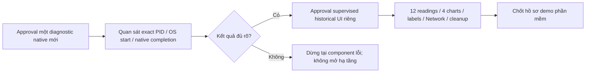

# Ma trận nghiệm thu cuối

Ngày05/11/2026. Status luôn đi cùng phạm vi; **COMPLETE_VERIFIED** không đồng nghĩa đang hoạt động hôm nay. Không kết nối DB/API/MQTT hoặc kiểm tra phần cứng mới trong đợt tổng hợp này.

| Hạng mục | Status | Loại bằng chứng / phần còn thiếu |
|---|---|---|
| Login, JWT, role/farm scope | COMPLETE_VERIFIED (DEV) | [Software DEV](archive/MVP_DEVELOPMENT_RUNTIME_ACCEPTANCE.md); AS/AT login200/CORS; không chứng nhận production security audit |
| Users/farms/zones/crops, CRUD và validation | COMPLETE_VERIFIED (DEV/SIMULATOR) | Nghiệm thu software29/10; không replay fixtures trong historical read-only |
| Device/sensor/actuator management | COMPLETE_VERIFIED (DEV); PARTIAL historical final | Existing eight identities Phase Y; ảnh Detail AT; nhãn sau AU/AW chưa browser final |
| DHT22/BH1750/soil ADC ingestion | COMPLETE_VERIFIED (real transport) | Y:3batches×4readings MQTT→DB/API; sensor accuracy/soil calibration chưa đạt |
| Presence ONLINE/OFFLINE | PARTIAL | Source watchdog/TTL/retained safety; Y fresh ONLINE; không fresh outage test ở phiên này |
| PostgreSQL readings/history REST | COMPLETE_VERIFIED (DEV, real source) | Y12/12 IDs/value/time/source; production hiện tại không đọc lại |
| Dashboard polling | COMPLETE_VERIFIED (software DEV); PARTIAL final historical | AS Dashboard hết API error; AR route sửa, AU labels và AW rendering cần nghiệm thu màn hình cuối |
| History/pagination/charts | COMPLETE_VERIFIED (software DEV); PARTIAL historical | Pagination29/10 đóng; AT chart TEMP và operator thấy bảng; thiếu đủ4charts/12rows/network sau AW |
| Threshold alerts / lifecycle | COMPLETE_VERIFIED (DEV simulation) | DEV alert OPEN→ACK→RESOLVED; không tạo cảnh báo giả trong historical DB |
| Manual irrigation command/ACK | PARTIAL, VERIFIED_REAL cho subcase motor | [12D4](archive/PHASE12D4_PHYSICAL_PUMP_ACCEPTANCE.md):2ON, max1s, ACK APPLIED/SUCCESS, MAX_RUNTIME; operator thấy motor tự dừng; chưa flow/pulse-width/full browser acceptance |
| Automatic irrigation | PARTIAL; VERIFIED_SIMULATION | SHADOW/domain và SQL test DB; automatic physical **BLOCKED**, chưa VERIFIED_LIVE/ACTIVE |
| Audit/error handling | PARTIAL | DEV audit CRUD có evidence; historical login audit memory-only, không nghiệm thu persistence từ phiên đó |
| Restart/recovery/persistence | PARTIAL | SQL59/59 thật + backup restore thật; native AX/UI startup completion còn BLOCKED |
| Demo cuối sau AW | BLOCKED | AX0/1 chưa startup; AZ chỉ candidate crash, không xác nhận đã sửa |

## Phân loại IoT trực tiếp

| Chức năng | Phân loại | Điều không được suy ra |
|---|---|---|
| ESP32→MQTT→DEV PostgreSQL→REST | VERIFIED_REAL (Phase Y, 02/11) | Không phải current live health hoặc browser E2E |
| Fresh PERIODIC OFF | VERIFIED_REAL (Y:3reports) | Không xác nhận động cơ/nước hiện tại |
| Motor chạy/tự dừng khoảng1s | VERIFIED_REAL, phạm vi quan sát người dùng | Không đo xung chính xác, chưa xác nhận nước; toàn phiên12D4 vẫn PARTIAL |
| Firmware expiry/duplicate/OFF priority/network failsafe | VERIFIED_SIMULATION và source review; physical fault tests IMPLEMENTED_NOT_VERIFIED | Không thử mất mạng/mất nguồn mới để ép PASS |
| SNTP callback | Có Serial callback counts lịch sử | Không nghiệm thu toàn bộ outage recovery hoặc Windows Time dài hạn |
| Automatic decisions/quota/idempotency | VERIFIED_SIMULATION / isolated SQL | Không automatic irrigation thật |
| SOIL calibration / VERIFIED_LIVE | BLOCKED | Numeric100% không phải calibration certificate |

## Critical path ngắn nhất

P0: native completion, website không overlay, đủ evidence màn hình/Network và cleanup, tuyên bố phạm vi demo trung thực. P1: reproducible startup, soil calibration nếu cần demo automatic thật, publisher/session/clock trust, credentials rotation có approval. P2: production irrigation migration/deployment, automation vật lý dài hạn, TLS/hardening bổ sung. Nếu đề cương bắt buộc tưới tự động **thật**, calibration/trust và acceptance phần cứng trở thành P0; không tự coi SHADOW thay thế yêu cầu đó.

Không cần hoàn tất R2.5/initdb55435 hoặc toàn bộ Phase13.5 để bảo vệ software MVP trên DEV đã có. Phải thống nhất phạm vi nghiệm thu với người hướng dẫn trước khi gọi toàn bộ đồ án hoàn thành.
