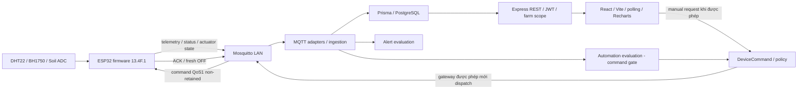

# Kiến trúc hệ thống Smart Agriculture

Cập nhật 05/11/2026 từ source và evidence. Tài liệu mô tả hệ thống đã triển khai; không xác nhận dịch vụ đang chạy. [Ma trận nghiệm thu](FINAL_FEATURE_ACCEPTANCE.md) phân biệt code, mô phỏng và phần cứng thật.

## Thành phần và luồng dữ liệu

Frontend có routes Dashboard, Farms, Zones, Crops, Devices/Detail, Sensors/History, Alerts, Irrigation, Reports, Activity Logs, Users và Settings (`frontend/src/routes/AppRoutes.tsx`). JWT/auth context và backend middleware/service enforce role/farm scope; ẩn nút trên UI không thay quyền backend. Users route giới hạn ADMIN.

Backend `src/server.ts` connect DB, gọi command recovery, listen HTTP, khởi động MQTT/presence nếu enabled. Đây **không phải entry read-only**: startup có thể ghi recovery/presence và ingestion. Vì vậy không dùng production bootstrap cho website historical. Shutdown dừng watchdog/MQTT rồi đóng HTTP và disconnect DB.

Prisma main schema có users, farms, farm_staff_assignments, zones, devices, actuators, device_commands, sensors, automation_rules, alert_rules, alerts, sensor_readings, crops, activity_logs và migration history riêng. Sáu ledger irrigation là proposal/repository được thử nghiệm cô lập, chưa nối production startup; không mô tả chúng là bảng production đã triển khai.

## Ba chế độ trình diễn cần tách biệt

| Chế độ | Dữ liệu / entry | Side effects và giới hạn |
|---|---|---|
| DEV/SIMULATOR | Dữ liệu test trong DEV riêng; nghiệm thu software 29/10 | Có fixtures/mutations theo scope phiên cũ; không chứng nhận phần cứng |
| Historical UI-only | `mvp-ui-only-session.ps1`, supervisor/worker/API/frontend riêng; SQL55433, API55001, UI55173 | 12 readings MQTT Phase Y đã lưu; guarded READ ONLY, auth audit memory-only, MQTT/commands/automation bị chặn |
| Real ESP32 ingestion / physical control | Broker thật, MQTT adapters, thiết bị thật | Cần approval riêng; hiện không được chạy trong đợt hoàn thiện offline |

Dedicated historical UI dùng identity allowlist của farm/zone/device/4 sensors/actuator và12 reading IDs (`mvp-ui-only-historical.cjs`). Mỗi DB path có READ ONLY/timeout; không gọi seed, migrations hoặc fake OFF. CORS/login được gate trước frontend. Đây không phải backend production đang vận hành.

## Cảm biến, timestamp và chất lượng

Firmware đọc DHT22 thành TEMP_01/HUM_01, BH1750 thành LIGHT_01, ADC thành SOIL_01. Serial PUBACK chỉ xác nhận broker nhận publish. Phase Y đối chiếu riêng receivedAt MQTT/DB và recordedAt/value/source của12 rows; không chứng minh calibration.

Phân biệt recordedAt (ESP32 đo), receivedAt (backend nhận), lastSeen (presence) và thời điểm trang được đọc. Không lấy độ trễ truyền tin làm clock skew đo chính xác. Historical timestamp hiển thị UTC+7; historical ONLINE/OFF không xác nhận kết nối/GPIO hiện tại. Polling có thể đọc lại dữ liệu cũ: không được gọi là LIVE chỉ vì UI tự cập nhật.

SOIL100% Phase Y không kèm raw ADC/calibration/quality wire metadata. ADC4095 trong Serial trước đó là bằng chứng lịch sử riêng; không gán nó cho batch Phase Y. SOIL vẫn **BLOCKED**, không dùng kích hoạt tự động.

## Command safety và ranh giới tự động

`frontend/src/utils/irrigation-control.ts` gửi ON với maxRunSeconds1, phân biệt PENDING/FAILED/ACK_TIMEOUT và ACK không xác nhận nước. `backend/src/services/pump-command-policy.ts` giới hạn `min(configured, testMode ? 1 : 5)`; source không thay thế serving runtime attestation.

Firmware `PumpProtocol.h` kiểm tra addressed command/expiry/clock/duplicate và runtime bằng monotonic time; OFF ưu tiên đưa LOW, kể cả khi ACK rejection phù hợp protocol. `.ino` chặn retained/wrong QoS/topic, boot LOW và giữ safety task/network lease; OFF định kỳ fresh khoảng15s. GPIO/ACK không phải motor/flow sensor.

SHADOW pure engine/preview và durable repository xử lý quyết định/budget/reservation/idempotency/safety state trong mock/test DB; không được suy VERIFIED_LIVE từ stored/live-observed fixtures. ACTIVE dispatch cần provenance/session/publisher/clock/soil quality/durable safety được nghiệm thu riêng.

## Bảo mật và vận hành

Không commit `.env`, `config.local.h`, dump, private logs, firmware chứa credentials hoặc ảnh token. Rotation Wi-Fi/device MQTT vẫn chưa có bằng chứng hoàn tất; MQTT LAN chưa TLS theo tài liệu hiện có. BitLocker/NTFS và backup/restore là phạm vi riêng, không bảo vệ mọi data exposure trên máy đang mở khóa.

Production5432, isolated TEST55433 và recovery55434 phải giữ identity tách biệt; không fallback DATABASE_URL. Không cần migration irrigation production để demo lịch sử trên DEV. Tham khảo [ARCHITECTURE.md](ARCHITECTURE.md), [báo cáo Y](archive/MVP_REAL_ESP32_END_TO_END_ACCEPTANCE.md) và [AZ](archive/MVP_PHASE_AZ_EVENT1000_1001_METADATA.md).
