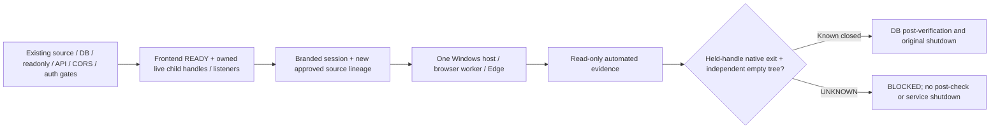

# Final automated Website lifecycle integration

06/11/2026. **SUPERVISOR_INTEGRATION_APPROVAL_REQUIRED**. Code tích hợp và offline tests đã hoàn thành; cần duyệt áp dụng đúng hai patch source đã pin. Không khởi động Edge, DEV services hoặc database trong phase này.

## 1. Kết quả thực hiện

Kế thừa adapter từ lần chuẩn bị trước, không xây lại từ đầu. Đã đọc báo cáo preparation, remediated Edge smoke, historical Website acceptance, existing session/supervisor/runtime/manual contract và các component liên quan.

Đã triển khai bridge, browser worker, Windows native provider và assertions bổ sung. Không còn placeholder callback làm blocker triển khai: `live-provider.cjs` thực hiện worker handoff, native host invocation và independent reconciliation. Điểm chặn hiện tại là **source-lineage approval cho hai file đang được REV10 pin**, không phải thiếu code hoặc thiếu browser capability.

Frontend vẫn REV10. Edge156.0.4314.58/Playwright1.62.1 capability **VERIFIED từ smoke trước**, không đồng nghĩa Website acceptance đã PASS. Approval smoke đã tiêu thụ không được dùng lại.

## 2. Actual files

Các implementation trong `scripts/frontend-acceptance/`:

| File | Trách nhiệm |
|---|---|
| `adapter.cjs` | Giữ workflow19 routes×5 viewport, đọc DOM, discovery IDs,10 screenshots, request policy, deadline và cleanup; bổ sung menu geometry, focus, charts/reports/detail checks và kết luận theo assertions bắt buộc |
| `assertions.cjs` | Detail identity/content; statistics/min/max/mean/count; single-bucket tooltip; clipping/occlusion; accessible labels; Settings read-only; Reports counts;403/404; cancel-only dialog trapping/Escape |
| `bridge.cjs` | READY binding, process-local branded session, validate original snapshots/CORS/auth/6-path readonly coverage, one worker, separate automated evidence và close barrier |
| `live-provider.cjs` | Approved source/runtime verification, fresh private run plan, transient credential pipe, native host execution, result correlation và independent process/profile reconciliation |
| `worker.cjs` | Browser-only child; source/env/parent/session checks, one Edge launch, native spawn boundary, read-only adapter, create-new PNG/result files; không DB/MQTT/gateway |
| `native-host.ps1` | Windows known-folder/SID/ACL/reparse verification, create-new private directories, bounded stdin, closed8-key env, independent held handles/FILETIME, ownership receipt, bounded verified-owned cleanup |
| `browser-environment.cjs` | Byte-identical copy của approved candidate, SHA256 `b1387aaf769b20b7a9fa65a371c8b8a500accdbd9d05c1c99c9e98f7d5f09b5d` |
| `source-contract.cjs` | Supplemental13-source pins,4 Edge/Playwright pins, explicit new automated execution/cleanup/credential-reuse permission và genuine source-lineage approval reference |
| `policy.cjs`, `contract.cjs`, `credential-source.cjs`, `credential-handoff.ps1` | Giữ policy/catalogue/secure UTF-8 handoff đã PASS; không mở rộng quyền điều khiển |
| `adapter.test.cjs`, `bridge.test.cjs`, `test-support.cjs` | Fake browser/process/channel/snapshot fixtures; không tạo screenshot nghiệm thu giả |

Runtime thật dự kiến dùng secure prompt của **existing launcher**, chuyển cùng Website credential đã nhập qua transient stdin tới supervised runtime. Staged runtime chỉ giữ bản sao trong memory cho browser khi approval mới cho phép reuse; credential được xóa tham chiếu/buffer sau handoff. Không cần hỏi PostgreSQL/MQTT password cho browser.

## 3. Minimal staged patch — chưa áp dụng

Không có extension point phù hợp trong active runtime để cấp trusted READY và chờ browser đóng. Vì vậy chuẩn bị hai candidate đầy đủ và unified diff tại:

`build/frontend-lifecycle-integration-4d13ea9ad1794ce0a1fd549f4fb63094/`

| Active file | Diff | Candidate |
|---|---|---|
| `scripts/mvp-ui-only-supervisor.cjs` | `mvp-ui-only-supervisor.cjs.patch`: +16/−5 lines | `staged/scripts/mvp-ui-only-supervisor.cjs` |
| `scripts/mvp-ui-only-runtime.cjs` | `mvp-ui-only-runtime.cjs.patch`: +17/−1 lines | `staged/scripts/mvp-ui-only-runtime.cjs` |

Không sửa `mvp-ui-only-session.ps1`. Không apply patch, không đổi active manifest, không tạo/kích hoạt REV11.

| File | Active original SHA256 | Staged candidate SHA256 |
|---|---|---|
| supervisor | `2ac398b3d654c2af2beb5bd8e5adabfbe18eeb24bccf7ca9d18562c3d9166e4b` | `b7d62547db2b8bd10b49fcd82a33f98cdea7d6623177ea21e433396ba7a5e0b2` |
| runtime | `671f45fc7c4cc3e237a4035e2db950405c4412dba7bd28dfe60ff15f62c772bf` | `ad31e89eba5980c792c72a5afc4594ed8c8a89ade7f6195bf8678368664f1e83` |

Patch SHA256 lần lượt:

- Supervisor: `fa2a16d4794038bf44daa17a9d4cba146e99605233d0f4799c9b9900b93e78b8`.
- Runtime: `55a2038d5681a640d0cd2e271274363cd96eb1bff54b11cc5cdf9cac44b12a50`.

Toàn bộ helper/test/dependency/binary hashes nằm trong `FINAL_FRONTEND_LIFECYCLE_SOURCE_PINS.json`, SHA256:
`b3b51b7ad27f97e3b1bb3a2e1212b45739f8543a04638c232b124119465c462f`.

Đây là **pins để review**, không phải execution plan hoặc approval. Pins preparation cũ được giữ làm lịch sử; không dùng chúng để chạy code mới.

## 4. READY và close barrier



READY không lấy từ một JSON `ready=true` hoặc polling file. Bridge chỉ được gọi trong staged supervisor sau existing gates. Nó revalidate11 migrations/checksums,12 readings, safe counts, ownership,6 readonly paths và toàn bộ pre-frontend CORS/auth evidence bằng các validators hiện có. Staged runtime giữ actual forked child references/IPC connection và kiểm tra đúng serving PIDs/listeners, source/runtime pins trước khi cấp binding.

Session được đánh dấu bằng process-local WeakMap, bound API/frontend/supervisor PIDs, DEV55433/systemID`7698826681383327460`/PGDATA đã pin, active REV10 baseline, session ID và≤600s deadline. Một bản JSON sao chép không có authority của session gốc. Metadata gửi sang browser child đi qua transient parent pipe, source/parent/approval/receipt checks; worker không tự phát hành READY.

Native host capture Windows known folders qua APIs, kiểm tra operator SID, canonical ancestors/reparse, owner/protected private DACL trước create-new; truyền đúng8 env keys, private TEMP/TMP/userDataDir. Không inheritance application secrets/NODE_OPTIONS, không personal Edge profile, không đổi sandbox/CDP TCP/flags/dependencies.

Provider giữ OS handles cho owned worker/Edge, đối chiếu executable/parent/owner/creation/profile, giữ native exit và OS ExitTime thật. Zero FILETIME hoặc timestamp không hợp lệ không thể thành PASS. Sau context close, child chờ independent native receipt; parent provider kiểm tra lại process graph/private-profile matches từ một observer khác.

**CLOSED** chỉ khi owners/handles/exits/timestamps đã biết, native codes là số, tree remaining0 và foreignTargeted0. Native nonzero nhưng chắc chắn đã đóng cho phép shutdown an toàn với kết quả PARTIAL; không biến thành UI PASS. Unknown/crash thiếu proof giữ barrier UNKNOWN và không cho post-verification/shutdown chạy. Không kill theo tên hoặc tự retry; unknown ownership bị bỏ qua và báo unresolved.

## 5. Automated evidence tách manual mode

- Mode mới explicit `AUTOMATED_BROWSER`; legacy MANUAL/default giữ nguyên hành vi và83 regressions.
- Summary có `automated.kind=AUTOMATED_BROWSER_EVIDENCE`,95-cell matrix, history/network/console/native/screenshot observations và barrier riêng.
- Không ghi `operator-acceptance.json`, không tạo `operatorAttested=true`, không biến95 cells thành12 manual booleans.
- Automated evidence không được giả là manual screenshot/attestation. Duplicate/foreign matrix cells, vượt10 images hoặc verdict sai schema bị từ chối.
- DB bounded digest, persisted audit/count invariants, source post-check, native completion và owned cleanup của supervisor vẫn giữ nguyên. Không nối irrigation repository hoặc gateway vào startup.

## 6. Assertions đã hoàn thiện

Catalogue giữ đúng19 routes, redirect `/` riêng; widths1440/1024/768/390/375. Mỗi cell có observations riêng, dùng đúng PASS/FAIL/NOT_VERIFIED/NOT_APPLICABLE.

| Nhóm | Implementation |
|---|---|
| Dynamic details | ID từ actual DEV links; URL và displayed deviceCode/name so với metadata snapshot đã validate; thiếu tên/record → NOT_VERIFIED |
| History4 types |3 DOM rows/type, units, MQTT source, recorded/received timestamps ngày02/11/2026/UTC+7, historical/SOIL notice |
| Chart statistics | Latest/min/max/average/count lấy từ DOM cards và đối chiếu actual DOM rows; missing em-dash không được ép thành số0 |
| Tooltip/aggregation | Hover actual SVG dot; đọc displayed tooltip, units/mean/min/max/count; kiểm tra one-bucket aggregation khi chứng minh được. Nhiều bucket không bị đánh FAIL chỉ vì không áp được phép so sánh toàn bộ rows |
| Reports | Chọn read-only30-day filter; so summaries với scoped verified snapshot counts; không export hoặc ghi dữ liệu |
| Settings | Xác nhận read-only notice và không có editable inputs/submit |
| Historical/missing/stale | Không gọi last-known là live; thiếu dữ liệu hiển thị riêng; trạng thái không có trong dataset giữ NOT_VERIFIED/NOT_APPLICABLE theo assertion, không giả response |
| Layout/a11y | Overflow, clipping/occlusion của visible controls, accessible names, focus-visible quan sát sau Tab; số đo không được gọi là full WCAG/contrast audit |
| Navigation | Desktop collapse/expand có width assertion; mobile open/close với geometry predicate; không click mutation buttons |
| Dialog | Chỉ dialog đã có sẵn và có nút Cancel/Hủy: focus hai hướng và Escape dismissal. Không mở Create/Delete/ON dialog để tạo điều kiện test; không có dialog → NOT_APPLICABLE |
| Empty/loading/error | Chỉ state thực sự xuất hiện trong UI được ghi observation; không chèn fixture response, sửa DB hoặc tạo outage |
| Irrigation | Disabled controls được kiểm tra khi có pump trong verified scope; không click ON/OFF/switch hoặc Automation |
| Network/errors | GET latest-readings200 và actual login200 là điều kiện full PASS; OPTIONS chỉ OBSERVED/NOT_OBSERVED; page errors không bị bỏ qua; Vite HMR WS bị chặn được phân loại riêng, không log raw console chứa secrets |

Assertions bắt buộc quyết định cell/full result. Optional state chưa tái hiện không cần giả PASS để hoàn thành các checks đã quan sát. Không có dữ liệu thật hoặc không đủ thời gian thì kết quả PARTIAL trung thực.

## 7. Security, deadlines và images

HTTP read-only policy giữ nguyên: approved DEV origins, GET/HEAD catalogue, exact login/logout POST và limited OPTIONS. Chặn writes, commands, shadow/live endpoints ngoài scope và WebSockets. Browser worker không có DB/MQTT clients. Credential unicode/whitespace không bị trim/normalize; không ghi password/JWT/cookies/storageState/HAR/trace.

Browser vẫn có thể dùng OS account/background networking; không gọi private profile là network isolation. Normal browser/app auth storage trong private runtime profile không được export thành evidence. Không xem/copy profile cá nhân.

Một launch, không fallback/retry. Session≤600s; bounded steps, launch≤18s; adapter dành45s cho close, callback cleanup≤30s; native host dành35s cho cleanup và hard monotonic cap. Timeout không gia hạn. Nếu host/ownership/cleanup chưa xác định, báo unresolved và để operator xử lý, không tự tiếp tục shutdown.

Tối đa10 screenshots như kế hoạch trước: Dashboard,4 History/Charts, Device Detail, Irrigation, Reports, Settings, mobile. PNG signature/size/dimensions/SHA256 được kiểm tra và create-new trong private run. Không screenshot Login/password; không tạo ảnh live trong phase này.

## 8. Offline verification thực tế

| Suite/check | Kết quả |
|---|---|
| Adapter + bridge/security/native/assertion integration | **90/90 PASS**, Node native exit0 |
| Full existing supervisor regressions, nạp staged supervisor trong riêng test process | **83/83 PASS**, native exit0 |
|95-cell traversal | Fake browser thực hiện đủ95 cells; không phải browser acceptance thật |
| Node syntax |15 CJS files gồm2 staged candidates,0 failures |
| PowerShell AST |4 sources: native host, credential helper, unchanged launcher và generated reconciliation query;0 errors |
| Manifest integrity |250 source+4 runtime+4 offline-test pins,0 drift |

**173 tests distinct PASS**, không cộng các lượt rerun. Các nhóm bao gồm source/approval/identity rejection, secure UTF-8 stdin/redaction, read-only/WS denial, native ownership/no retry, close-before-post-check/shutdown, crash/timeouts/UNKNOWN và legacy manual compatibility.

Windows host source/cleanup guards được AST/static review và fake receipt tests; **chưa thực thi Windows provider cho Website**. Không lấy fake results thay real-native Website proof. Một lỗi collector PowerShell Measure-Object đã được sửa ở bước thu metadata; không đổi/mask test exit codes và không coi đó là lỗi browser.

Evidence folder: `build/frontend-lifecycle-integration-4d13ea9ad1794ce0a1fd549f4fb63094/`, gồm final TAP, verification JSON, staged sources/diffs và prep script có exact source-anchor/hash guards. Không chạy lại toàn bộ frontend/system tests đã PASS vì không đổi frontend/domain/runtime đang hoạt động.

## 9. Phê duyệt còn thiếu và phiên thực thi tiếp theo

**Cần duyệt source lineage trước**, cho đúng hai staged file và supplemental helper/binary pins; chưa apply. Không sử dụng active REV10 như thể nó đã pin hai candidate mới. Nếu chọn approved execution-overlay so với REV10 baseline, phải ghi rõ hai old→new hashes và source-lineage approval trong plan; nếu dùng revision manifest mới thì cần review/authorization riêng. Phase này không tự chọn/kích hoạt cả hai cách.

Sau source approval thực sự, một phiên Website cần approval mới riêng hoặc cùng văn bản chỉ khi người dùng nêu rõ cả source activation và one-session execution:

1. Recheck active/old hashes và candidate/helper pins; áp dụng đúng phạm vi lineage đã duyệt, không copy đè nếu phát hiện drift. Giữ frontend REV10, tất cả runtime safety/DB gates.
2. Tạo genuine fresh plan qua existing launcher contract: maxSessions1, manualSeconds≤600, current expiry; `acceptanceMode=AUTOMATED_BROWSER`, `allowWebsiteCredentialReuseForBrowser=true`, actual source-lineage file/hash, approved effective source hashes,13 supplemental source pins và4 browser binary pins. `automatedBrowser` phải có execution/verified-owned cleanup permission, maxLaunches1 và đúng approval SHA. Không tự tạo các giá trị này từ approval preparation hiện tại.
3. Operator nhập Website DEV credential qua existing secure prompt tại máy. Không PostgreSQL/MQTT credential, không gửi qua chat. Legacy launcher vẫn có lời nhắc manual; trong automated mode không cần mở browser thủ công hoặc chụp ảnh.
4. Existing supervisor thực hiện preflight/readonly DB/CORS/auth/frontend gates; bridge chỉ nhận control sau READY. Nếu bất kỳ gate fail thì không launch browser.
5. One headless Edge worker chạy adapter; thu matrix/images/network/native evidence. Không thêm second browser, retry, Save/Delete/ON/OFF hoặc Automation.
6. Chờ CLOSED/native reconciliation; rồi post-verify DB/source/audit và shutdown owned DEV services bằng path cũ. UNKNOWN thì không bỏ barrier hoặc force-kill process lạ; báo services left-running cho operator.
7. Xuất kết quả thật PASS/PARTIAL/FAIL cùng screenshot references; không biến nó thành manual attestation, live MQTT acceptance, SOIL calibration hoặc physical auto-irrigation acceptance.

Không có live command được cung cấp để chạy ngay một patch chưa được duyệt. Chưa tiêu thụ Website attempt0/1.

## 10. Final verdict

```text
SMART AGRICULTURE — WEBSITE ACCEPTANCE INTEGRATION
Frontend revision: REV10
Browser capability: VERIFIED (previous approved smoke)
Adapter core: READY (offline implementation)
Lifecycle bridge: READY (staged integration, not activated)
Trusted DEV session binding: PASS (offline tests)
Browser close-before-shutdown: PASS (offline tests)
Credential handoff: PASS (synthetic; no real password input)
Read-only network policy: PASS (offline tests)
19-route coverage: READY (real observations pending)
95-cell matrix: READY (fake traversal; live pending)
Screenshot capture: READY (no new real screenshots)
Offline tests: 90/90 PASS
Supervisor regressions: 83/83 PASS
Pinned source changes applied: 0
Staged patch required: YES (2 files)
Manifest: REV10 UNCHANGED
Actual browser acceptance: NOT_EXECUTED
Website live attempts: 0/1
FINAL: SUPERVISOR_INTEGRATION_APPROVAL_REQUIRED
```

Không start services/database/browser, MQTT/DeviceCommand/ON/OFF/Automation/migrations/firmware/hardware. Trạng thái production hiện hành không được suy từ tests offline. STOP tại ranh giới source-lineage approval.
