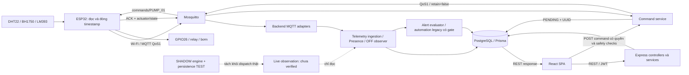
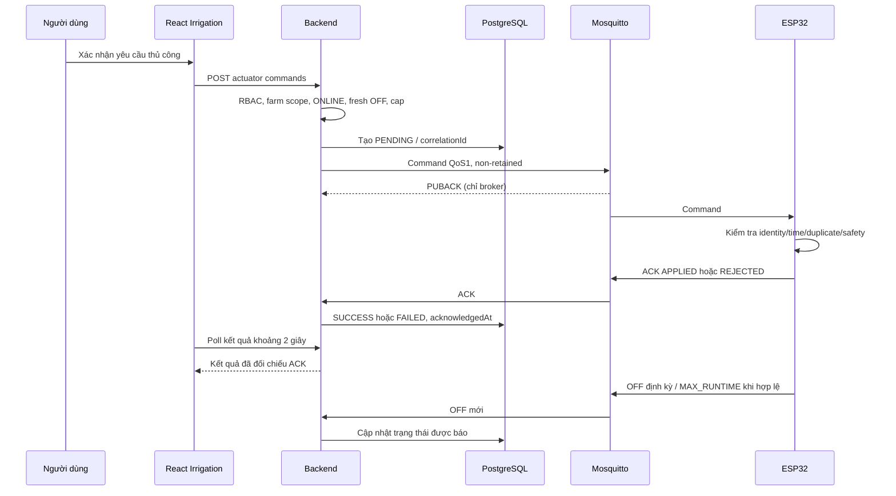
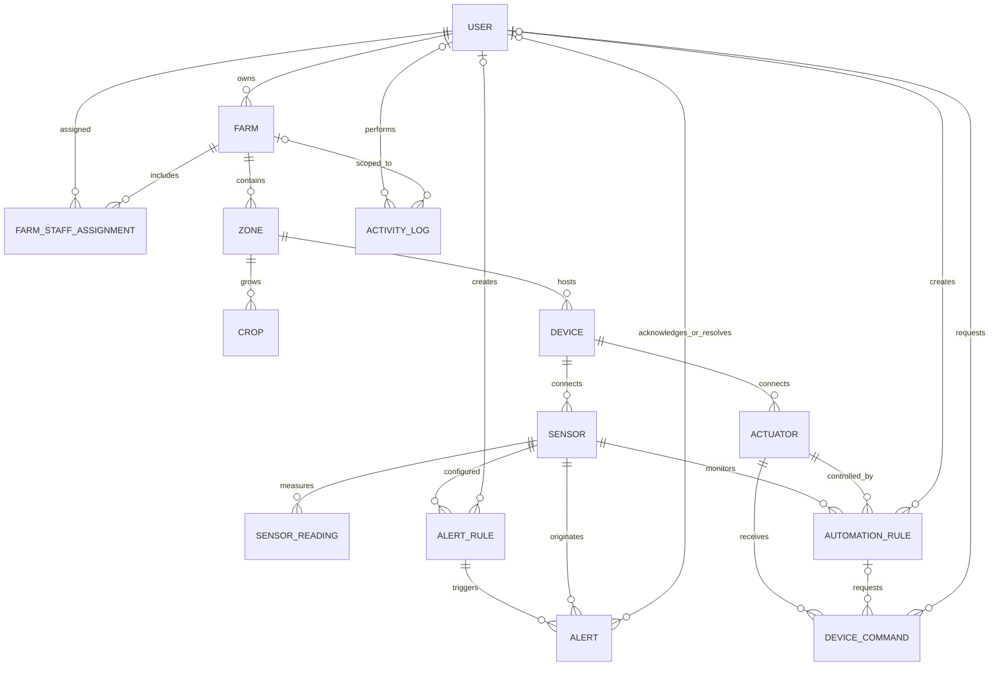
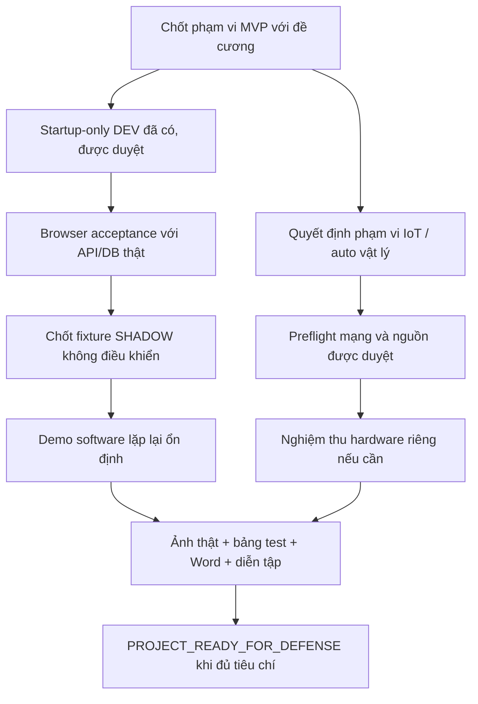

# SMART AGRICULTURE IoT — TỔNG QUAN VÀ REVIEW DỰ ÁN

**Đề tài:** Xây dựng hệ thống quản lý và giám sát nông nghiệp thông minh tích hợp IoT.  
**Repository:** C:\DATN\Project_datn — GitHub được người dùng cung cấp: https://github.com/khoii1/Project_DATN.  
**Ngày tổng hợp:** 29/10/2026, múi giờ UTC+7. Snapshot runtime gần nhất trong đợt review: 00:10:37 ngày 29/10/2026.  
**Mục đích:** Bàn giao thông tin thực tế cho việc viết báo cáo đồ án Word; không phải giấy chứng nhận hệ thống production đang vận hành.

## 1. Kết luận tổng quan

Dự án đã xây dựng được một hệ thống full-stack gồm React, Express/Node.js, PostgreSQL/Prisma, Mosquitto MQTT và firmware ESP32. Có quản lý tài khoản, trang trại, khu vực, cây trồng, thiết bị, cảm biến, cảnh báo, lịch sử, báo cáo và tưới thủ công. Luồng bốn cảm biến thật tới database/API đã có bằng chứng kiểm chứng trong các phase trước. Máy bơm đã được người dùng xác nhận chạy và tự dừng khoảng một giây; bằng chứng phần mềm cần được trình bày cùng các giới hạn đo lường, không suy ra lưu lượng nước hay độ chính xác xung GPIO.

Phần mềm development gần nhất đã đạt **43 kiểm tra API/database PASS**, nhưng nghiệm thu trình duyệt với API DEV thật chưa hoàn tất. Bộ offline gần nhất có **556/556 PASS**, bao gồm nhiều nhóm kiểm thử; đây không phải 556 lần thử phần cứng. Tưới tự động có evaluator ngưỡng cũ, pure engine SHADOW và nền tảng persistence riêng, nhưng chưa có bằng chứng nghiệm thu tưới tự động vật lý hoàn chỉnh hoặc VERIFIED_LIVE/ACTIVE an toàn.

Tại snapshot hiện tại, **không có backend5000, frontend5173 hoặc DEV55001/55173 đang lắng nghe**. PostgreSQL5432 có listener; Mosquitto1883 chỉ thấy listener loopback. Vì vậy không được viết rằng hệ thống đang thu nhận dữ liệu ESP32 liên tục ở thời điểm review. Trạng thái thực của ESP32, readings mới, PENDING và safety flags runtime hiện tại chưa được truy vấn/xác minh.

**Kết luận bàn giao:** Nền tảng và phần lớn chức năng MVP đã có code cùng bằng chứng kiểm thử đáng kể. Trạng thái phù hợp hiện nay là **MVP_DEV_SOFTWARE_PARTIAL / PROJECT_NOT_READY_FOR_DEFENSE**, cần hoàn tất nghiệm thu UI thật, khôi phục môi trường demo được duyệt, chốt phạm vi tưới tự động với giảng viên và bổ sung kết quả thực nghiệm vào Word. Không cần hoàn tất mọi nhánh hardening Phase13.5 để trình diễn MVP development cô lập.

### 1.1 Cách đọc trạng thái và bằng chứng

| Nhãn | Ý nghĩa trong tài liệu này |
|---|---|
| COMPLETE_VERIFIED | Có bằng chứng đã thực thi thành công, chỉ trong môi trường và cửa sổ quan sát được nêu |
| IMPLEMENTED_NOT_VERIFIED | Có implementation, chưa có kiểm chứng đầy đủ cho trường hợp đang xét |
| PARTIAL | Có phần đã đạt, còn khoảng trống nghiệm thu hoặc tích hợp |
| BLOCKED | Chưa thể thực hiện bước kế tiếp do điều kiện cụ thể chưa đạt |
| NOT_IMPLEMENTED | Chưa có implementation tương ứng |
| NOT_REQUIRED | Không phải yêu cầu bắt buộc đã xác định trong đề cương hiện có |
| NOT_VERIFIED | Chưa đủ bằng chứng; không đồng nghĩa chắc chắn lỗi |

Thứ tự ưu tiên bằng chứng: source/contracts hiện hành → kết quả thực thi có môi trường/thời điểm → báo cáo phase → README/nhận định cũ. Code chứng minh thiết kế, không tự chứng minh phần cứng hoặc runtime hiện tại. PASS cũ không được dùng thay freshness mới.

Review bao gồm inventory source chính, đọc sâu các entrypoint, nghiệp vụ, schema, hợp đồng MQTT, firmware và bằng chứng kiểm thử liên quan. Không có tuyên bố đã đọc từng dòng node_modules, generated code hay artifacts riêng tư. Trong đợt review này không chạy test, SQL, dịch vụ, MQTT command, flash hoặc thao tác bơm. Chỉ tạo tài liệu Markdown này; không sửa source.

## 2. Phạm vi đồ án và đề cương thực tế

Đã đọc **DeCuongDATN.docx** tại đường dẫn người dùng cung cấp trong Downloads. SHA256:

`558DC1F48199649629E312A0749A3C11158BB026677663544EC12EDE172A56E3`

Đề cương có các phần Mở đầu, **TỔNG QUAN TÀI LIỆU**, **PHƯƠNG PHÁP THỰC HIỆN**, **CÀI ĐẶT THỰC NGHIỆM**, **KẾT LUẬN**, **DỰ KIẾN KẾ HOẠCH THỰC HIỆN** và tài liệu tham khảo. Cần giữ cấu trúc này khi viết Word; không tự tách thêm Chương 4 nếu bản được giảng viên duyệt chưa có. Phần cài đặt/thực nghiệm và kết luận còn chủ yếu là đề mục, chưa có báo cáo kết quả đủ để nghiệm thu. Có 11 ảnh nhúng khác nhau: logo trường và các sơ đồ Use Case; chưa phải bộ ảnh phần cứng, ERD hoặc ảnh chụp kết quả vận hành. Nhiều sơ đồ kỹ thuật còn là ghi chú cần bổ sung.

Thời gian dự kiến trong đề cương: **24/08/2026–15/01/2027**. Bảng kế hoạch ghi 15 tuần, cần đối chiếu lại lịch thực tế vì khoảng ngày dài hơn 15 tuần.

| Yêu cầu thực tế | Implementation/bằng chứng | Đánh giá |
|---|---|---|
| Đăng nhập, vai trò, quản lý người dùng | JWT, bcrypt, ADMIN/FARM_OWNER/STAFF, API DEV có kiểm tra cho phép/từ chối | API verified; UI live chưa đủ |
| Trang trại/khu vực/cây trồng/phân công | Schema, API, form và farm scope; DEV kiểm tra tạo/đọc/sửa | Phần lớn đã triển khai |
| Thiết bị/cảm biến/actuator | Quan hệ đầy đủ, mã thiết bị/cảm biến, operational status và connection status tách biệt | API verified trong DEV |
| Thu nhận môi trường IoT | DHT22/BH1750/LM393, MQTT, SensorReading | Có kiểm chứng phần cứng lịch sử; hiện tại chưa xác minh |
| Giám sát/latest/history/chart/statistics | REST và React polling, biểu đồ Recharts, khoảng thời gian | API và offline verified; browser DEV thật còn thiếu |
| Cảnh báo ngưỡng và vòng đời | AlertRule, OPEN/ACKNOWLEDGED/RESOLVED, hysteresis | DEV API/DB verified |
| Tưới thủ công/lịch sử | API → MQTT → ACK, giới hạn thử 1 giây, DeviceCommand | Có thử vật lý lịch sử; nghiệm thu tổng thể PARTIAL |
| Tưới tự động theo độ ẩm đất | Evaluator legacy + SHADOW engine và persistence test | PARTIAL; chưa nghiệm thu tự động vật lý an toàn |
| Báo cáo/nhật ký | Reports API, CSV, ActivityLog | API có bằng chứng; UI live chưa đủ |

Yêu cầu phi chức năng gồm bảo mật/phạm vi dữ liệu, lưu timestamp đo, tiếp nhận liên tục, trạng thái thiết bị, giao diện rõ ràng và khả năng mở rộng nhiều trang trại. Đề cương không đặt SLA định lượng về tải, uptime, độ trễ hoặc độ chính xác nông học. Không tự thêm số liệu hiệu suất. Các use case không yêu cầu DELETE phá hủy cho mọi đối tượng; thiếu DELETE tổng quát không tự động là thiếu chức năng đồ án. Một số sơ đồ báo cáo/nhật ký thiên về Admin trong khi API cho người dùng đã đăng nhập xem dữ liệu trong farm scope; cần thống nhất mô tả quyền giữa Word và implementation.

## 3. Công nghệ và cấu trúc mã nguồn

### 3.1 Stack đã kiểm tra

Các phiên bản dưới đây là metadata cài đặt cục bộ tại thời điểm review, có thể khác version range trong package.json. Đây không phải khẳng định phiên bản đang chạy trên một server triển khai khác.

| Thành phần | Công nghệ/phiên bản cài đặt | Vai trò |
|---|---|---|
| Runtime | Node.js22.20.0, npm10.9.3 | Backend và công cụ build/test |
| Frontend | React/react-dom19.2.8, TypeScript5.8.3 | SPA, component, hooks/context |
| Điều hướng/API | React Router DOM7.18.2, Axios1.19.0 | Route bảo vệ, gọi REST |
| UI/chart/build | Tailwind3.4.19, Lucide, Recharts3.10.1, Vite7.3.6 | Giao diện và biểu đồ |
| Backend | Express4.22.2, TypeScript5.9.3 | REST API, middleware, services |
| ORM/database | Prisma/client6.19.3, PostgreSQL17; binary17.2 trong môi trường kiểm thử | Schema, truy vấn, migration |
| MQTT | MQTT.js5.15.2; Mosquitto Windows native | Broker và client backend |
| Validation/security | Zod3.25.76, jsonwebtoken9.0.3, bcryptjs3.0.3, Helmet/CORS/rate limit | Kiểm tra input và xác thực |
| Firmware | Arduino C++/ESP32, ArduinoMqttClient, DHT, BH1750, FreeRTOS/SNTP | Đo cảm biến và điều khiển relay |

Build firmware lịch sử dùng ESP32 Arduino core3.3.12, ArduinoMqttClient0.1.8, DHT1.4.7, Unified Sensor1.1.15, BH17501.3.0, FQBN esp32:esp32:esp32. Đây là metadata build đã báo cáo, không phải kiểm chứng lại toàn bộ toolchain hôm nay. Mosquitto từng được báo cáo version2.1.2 trong Phase13.4H.1; version của tiến trình hiện tại chưa được xác minh lại. Không tìm thấy Dockerfile/Compose cho deployment hiện tại; không nên mô tả hệ thống đang chạy bằng Docker.

Nguồn: [frontend/package.json](frontend/package.json), [backend/package.json](backend/package.json), lockfiles và metadata package cục bộ; [báo cáo broker/staging](docs/PHASE13_4H1_BROKER_AND_STAGING_VERIFICATION.md).

### 3.2 Cây module chính

```text
Project_datn/
├─ frontend/src/
│  ├─ routes, layouts, pages, components
│  ├─ contexts, hooks, services, types, utils
├─ backend/src/
│  ├─ routes, controllers, services, repositories
│  ├─ validators, middlewares, config, utils
│  ├─ mqtt, gateways
├─ backend/prisma/
│  ├─ schema.prisma, migrations/        # 11 migration nền
│  └─ proposals/                       # 6 ledger tưới, chưa production
├─ backend/scripts/                    # test, simulator, công cụ QA
├─ firmware/SmartAgricultureESP32/      # ino và các lớp protocol/clock/safety
├─ firmware/tests/                     # kiểm thử host, không phải phép đo điện
├─ infrastructure/mosquitto/           # hướng dẫn, config/ACL mẫu
├─ scripts/                            # orchestration DEV/recovery/acceptance
├─ docs/                               # thiết kế, báo cáo phase
└─ build/                              # artifacts/evidence; không chia sẻ hàng loạt
```

Một số build/config/log riêng tư có thể chứa secrets hoặc dữ liệu production; không đưa nguyên thư mục build hay local config vào phụ lục/Git/ChatGPT. Tài liệu này không chứa mật khẩu hoặc dump dữ liệu.

## 4. Kiến trúc tổng thể và luồng dữ liệu



Mũi tên SHADOW ở đây thể hiện quan hệ thiết kế/đánh giá dữ liệu; live-observation hiện **không gọi engine và không dispatch command**. REST polling được dùng thay WebSocket/SSE. React không kết nối trực tiếp MQTT hoặc PostgreSQL.

### 4.1 Luồng telemetry

1. ESP32 đọc một bộ bốn cảm biến, lấy UTC tại thời điểm đo khi clock đáng tin cậy.
2. Publish JSON schemaVersion1 lên telemetry, QoS1, không retained. Thiếu thời gian hợp lệ thì bỏ mẫu; không gán giờ mới cho mẫu cũ.
3. Backend parse topic, validate JSON, đối chiếu Device/Sensor đã đăng ký và trạng thái ACTIVE.
4. Lưu SensorReading với source MQTT; unique sensorId/recordedAt chống ghi trùng. recordedAt là giờ đo, receivedAt là giờ server tiếp nhận.
5. Dữ liệu đủ freshness/trust mới được dùng cho side effects cảnh báo/automation. Dữ liệu cũ/retained có thể được lưu lịch sử nhưng không tự chứng minh liveness hoặc cho phép tưới.
6. Frontend gọi REST để lấy latest/history/chart/statistics, tự cập nhật bằng polling.

Nguồn: [MQTT client](backend/src/mqtt/mqtt-client.service.ts), [router](backend/src/mqtt/mqtt-message-router.ts), [schema](backend/src/mqtt/mqtt-message.schema.ts), [telemetry adapter](backend/src/mqtt/mqtt-telemetry.adapter.ts), [ingestion service](backend/src/services/telemetry-ingestion.service.ts).

### 4.2 Luồng command và ACK



PUBACK không phải ACK thực thi của ESP32. ACK/GPIO không chứng minh motor quay hay nước chảy. API nhận yêu cầu không được hiển thị như đã bật thành công; timeout không phải thành công.

### 4.3 Entry points và startup side effects

- Frontend: main.tsx → StrictMode/BrowserRouter → App/AuthProvider → AppRoutes.
- Backend: [server.ts](backend/src/server.ts) → kết nối database → recoverMqttCommands → HTTP → MQTT/watchdog theo cấu hình.
- Recovery có cập nhật DeviceCommand/trạng thái actuator trong database; vì vậy **khởi động backend không phải thao tác chỉ đọc**. Không thấy startup tự migrate/seed, nhưng vẫn cần đúng môi trường và phê duyệt startup.
- API composition: routes → middleware → controller → service → repository/Prisma. Dashboard dùng nhiều API hiện có, không có endpoint dashboard riêng.

## 5. Frontend và cơ chế giám sát

Nguồn định tuyến: [AppRoutes.tsx](frontend/src/routes/AppRoutes.tsx). Các trang dưới layout đều cần đăng nhập, riêng Users yêu cầu ADMIN. Quản lý farm scope vẫn do backend kiểm tra; ẩn nút trên UI không thay thế authorization.

| Route | Chức năng và API chính | Trạng thái/bằng chứng |
|---|---|---|
| /login | Login, lưu token theo lựa chọn ghi nhớ; auth/login, auth/me | DEV API verified, UI DEV chưa nghiệm thu |
| /dashboard | Summary thiết bị/cảnh báo, latest theo zone, actuator và dữ liệu tổng hợp | Code thật, API composition; polling10s |
| /farms, /farms/:farmId | Danh sách/chi tiết, form farm, phân công staff và quyền tưới | DEV API create/read/update/scope verified |
| /zones, /zones/:zoneId | Khu vực, dữ liệu cảm biến theo khu vực | API zones, zones/:zoneId/latest-readings; overview polling10s |
| /crops | Cây trồng/mùa vụ/trạng thái, lọc farm/zone | Code/API có; UI live chưa verified |
| /devices, /devices/:deviceId | Device, operational/connection status, latest readings | devices/summary, devices, latest-readings; polling10s |
| /sensors | Cảm biến, số đo gần nhất/timestamp, lọc/phân trang | sensors/summary, sensors; polling10s |
| /sensors/history | Dữ liệu lịch sử, chart, statistics, khoảng thời gian | sensors/:id/readings, chart, statistics; refresh theo lựa chọn |
| /alerts | Cảnh báo, rule và vòng đời xử lý | alerts/summary/list/acknowledge/resolve, alert-rules; polling10s |
| /irrigation | Tưới thủ công, lịch sử, automation và SHADOW tabs | actuators, device-commands, automation-rules; manual/history polling2s |
| /reports | Tổng hợp, lọc khoảng thời gian, CSV | reports/overview/sensors/alerts/irrigation/automation/export |
| /activity-logs | Nhật ký theo scope/bộ lọc | activity-logs |
| /users | Quản lý người dùng, trạng thái/vai trò | users; chỉ ADMIN |
| /settings | PlaceholderPage | Chưa có chức năng hoàn chỉnh; không tự coi là P0 |
| /forbidden, wildcard | 403 và 404 | Đã có component/route |
| / | Redirect dashboard | Không phải trang nghiệp vụ riêng |

Không có một route Monitoring hoặc Automation riêng; chức năng được ghép vào các trang trên. SensorDataPage placeholder không phải trang cảm biến được route sử dụng. dashboard.mock.ts tồn tại không chứng minh dashboard đang dùng mock; active dashboard gọi services thật.

### 5.1 Polling, state và hiển thị

- [usePolling.ts](frontend/src/hooks/usePolling.ts), [polling.ts](frontend/src/utils/polling.ts): mặc định 10 giây sau khi lượt trước hoàn tất, tuần tự, không chồng request trong cùng controller.
- AbortController, dispose/scope generation loại bỏ response cũ khi unmount/đổi scope; tab ẩn dừng và hủy, tab hiện lại refresh. StrictMode được xử lý cleanup. Loading nền không làm reset toàn bộ trang hoặc form.
- Irrigation theo dõi khoảng 2 giây. Poll2s có thể không thấy pha ON chỉ tồn tại1s; không được tự gửi ON lần nữa chỉ để thấy UI đổi trạng thái.
- History không polling toàn bộ lịch sử mỗi10s. Refresh khoảng tương đối cập nhật thời điểm kết thúc; custom range giữ nguyên, tránh thêm dữ liệu ngoài khoảng chọn.
- Giá trị0 hợp lệ khác null/không có dữ liệu. Timestamp lấy từ recordedAt backend, không đổi thành giờ hiện tại để giả dữ liệu mới.
- Nhiều format ngày dùng locale vi-VN nhưng không chỉ rõ timezone; phụ thuộc timezone trình duyệt. SHADOW có timezone Việt Nam tường minh. Cần nghiệm thu UTC+7 trên UI thật.
- Axios timeout5s, Bearer token;401 xóa token. AuthProvider khi khôi phục phiên có catch rộng có thể xóa session cả khi backend lỗi mạng tạm thời; đây là rủi ro static, chưa chứng minh thành lỗi runtime trong review.
- Một số trang quản lý như Crops còn effect không truyền AbortSignal đầy đủ: nguy cơ response scope cũ ghi đè khi đổi nhanh. Cần kiểm thử có mục tiêu, không tự kết luận mọi trang lỗi.

### 5.2 Irrigation UI và khoảng trống DEV fixture

[irrigation-control.ts](frontend/src/utils/irrigation-control.ts) tạo ON với maxRunSeconds=1; OFF không cần thời lượng. pumpPresentation chỉ cho ON khi ONLINE, OFF tin cậy, có quyền và không pending; UNKNOWN/OFFLINE khóa ON. REJECTED/TIMEOUT không được báo ON thành công.

SHADOW UI hiện tìm đúng **ESP32-GF-A-01**, và API shadow-preview/live-evidence cũng giới hạn mã này. DEV seed dùng **MVP-SIM-A-01/B-01** để tách khỏi identity vật lý. Đây là **mâu thuẫn contract/fixture xác định từ source**, nên testcase mong có SHADOW preview ở DEV sẽ thiếu target. Chưa quan sát lỗi bằng browser live vì browser không chạy được trong phiên DEV trước. Cần thiết kế fixture preview riêng, giữ nhãn simulation; không tạo thiết bị giả mang identity thật để vượt trust gate.

## 6. Backend: nghiệp vụ, bảo mật và quyền truy cập

### 6.1 Authentication và authorization

- JWT access token; thời hạn mặc định1 ngày theo cấu hình; bcrypt cost12. Email được trim/lowercase.
- authenticate đọc user hiện hành từ database; user inactive bị chặn. ADMIN quản lý toàn hệ thống; FARM_OWNER chỉ farm sở hữu; STAFF chỉ farm được phân công.
- FarmStaffAssignment.canControlIrrigation là quyền bổ sung cho STAFF thực hiện tưới. Service kiểm tra farm và trạng thái thiết bị/actuator, không chỉ kiểm tra role.
- Logout ghi nhật ký và xóa token phía client; chưa có blacklist thu hồi JWT toàn cục. Không mô tả logout như token bị vô hiệu hóa ở mọi nơi ngay lập tức.
- Login có rate limit15 phút, ngưỡng development50 và môi trường còn lại10. Zod validate params/query/body. AppError trả lỗi có kiểm soát; lỗi không biết được sanitize trong production.
- Helmet, CORS theo clientUrl, JSON limit1MB; Morgan phục vụ log HTTP. JWT không tự mã hóa nội dung payload và không thay thế TLS.
- Tenant isolation nằm ở farmScope/service, chưa có bằng chứng PostgreSQL RLS theo từng tài khoản web. Database login role khác User.role của ứng dụng.

Nguồn: [app.ts](backend/src/app.ts), [auth middleware](backend/src/middlewares/auth.middleware.ts), [farm repository](backend/src/repositories/farm.repository.ts), [command service](backend/src/services/device-command.service.ts), các auth/authorize/validator modules. API inventory chính xác ở phụ lục.

### 6.2 Sensors, history, alert, reports

- SensorReading lưu số đo, source và hai mốc thời gian. Các API lịch sử có lọc khoảng ngày, chart aggregation và statistics; giới hạn khoảng truy vấn tối đa90 ngày, raw chart có giới hạn số điểm, không stream toàn bộ database vào chart.
- AlertRule định nghĩa operator/threshold/recoveryThreshold/severity. Evaluator mở cảnh báo khi vượt ngưỡng, cập nhật last value; hysteresis cho phục hồi. OPEN → ACKNOWLEDGED → RESOLVED không đồng nghĩa ACK là đã hết tình trạng lỗi.
- Partial unique index giới hạn một cảnh báo active/rule. Duplicate hoặc out-of-order có gate, không mở hàng loạt cảnh báo từ cùng mẫu.
- Reports là truy vấn theo farm scope và thời gian. CSV có BOM, escaping, phòng tiền tố công thức; có giới hạn100000 dòng. Không gọi đây là báo cáo phân tích AI hay dự báo mùa vụ.
- ActivityLog ghi ai/lúc nào/hành động/đối tượng/farm/IP phù hợp. recordActivity bắt lỗi để không phá giao dịch chính; đây là **best-effort activity log**, chưa phải immutable audit ledger. Append-only được kiểm thử riêng ở proposed irrigation_decision_logs.

### 6.3 Giới hạn lỗi cần ghi trung thực

Ingestion lưu readings rồi đánh giá alert/automation không phải một outbox transaction chung. Nếu evaluator ném lỗi sau insert, row có thể đã lưu nhưng adapter báo xử lý không trọn vẹn; retry duplicate không tự tái chạy side effects của row đã tồn tại. Đây là khoảng trống fault recovery từ source, chưa có bằng chứng lỗi này đang xảy ra. Không tuyên bố exactly-once toàn bộ nghiệp vụ chỉ vì unique key chống trùng reading.

Health HTTP200 chủ yếu phản ánh DB connected; trạng thái MQTT có trường riêng. TCP1883 mở không chứng minh backend MQTT authenticated/subscribed. Health không phải giấy phép điều khiển.

## 7. Database và mô hình dữ liệu

Nguồn chuẩn: [schema.prisma](backend/prisma/schema.prisma). Có **14 Prisma model** tương ứng14 bảng nghiệp vụ; thêm _prisma_migrations thành15 bảng nền trong môi trường đã kiểm chứng. Phụ lục cuối có inventory toàn bộ field/enum trực tiếp từ schema, không chứa dữ liệu thực.

| Bảng | Trách nhiệm và khóa quan trọng |
|---|---|
| users | Account, email unique, passwordHash, role/status |
| farms | Farm và owner; owner FK không được xóa tùy tiện |
| farm_staff_assignments | Liên kết farm/staff unique, quyền canControlIrrigation |
| zones | Zone thuộc farm; unique farmId/name |
| crops | Cây trồng/mùa vụ, các ngày trồng/thu hoạch, zone |
| devices | deviceCode unique, loại/model, operational status, connectionStatus, lastSeenAt |
| sensors | Sensor thuộc device; zone suy qua device.zoneId; unique deviceId/sensorCode |
| sensor_readings | value/source/recordedAt/receivedAt; unique sensorId/recordedAt |
| actuators | Pump/actuator thuộc device; zone suy qua device.zoneId; unique deviceId/actuatorCode; trạng thái được báo |
| device_commands | Lịch sử command/nguồn/trạng thái/correlationId/expiry/duration/ACK |
| automation_rules | Soil sensor, pump, start/stop thresholds, enabled, watermark |
| alert_rules | Threshold, recovery threshold, operator, severity và sensor |
| alerts | Vòng đời cảnh báo, snapshot rule/value, acknowledge/resolve actors |
| activity_logs | Hoạt động người dùng theo farm và đối tượng |

PK phần lớn là String cuid. Foreign keys bảo toàn các liên kết; nhiều nhánh có Cascade, actor tùy chọn SetNull, owner Restrict. Không được suy rằng có thể DELETE mọi farm/device mà không ảnh hưởng history. DateTime hiện dùng PostgreSQL TIMESTAMP(3) theo migration; không phải TimescaleDB, cũng không được mặc định toàn bộ là TIMESTAMPTZ. API dùng ISO timestamp; phải giải thích rõ UTC và timezone hiển thị.

### 7.1 ERD quan hệ chính



ERD này nhóm các quan hệ actor cho dễ đọc; khi vẽ bản vật lý Word cần tách acknowledgedBy và resolvedBy thành hai FK, dùng tên SQL/nullable/onDelete từ schema. Sensor và Actuator không có FK zoneId riêng; khu vực được suy qua Device. AutomationRule dùng field sensorId, không phải một field soilSensorId trong main schema. Không thêm sáu ledger proposal vào ERD production như thể đã triển khai.

### 7.2 Migration nền

1. 20260826044448_add_users_auth
2. 20260826053517_add_farms_zones_crops
3. 20260826064902_add_iot_devices
4. 20260826091140_add_sensors_and_readings
5. 20260826143000_rename_temperature_sensor_type_to_temp
6. 20260827022817_add_alert_rules_and_alerts
7. 20260827032735_add_actuators_and_device_commands
8. 20260827113854_add_automation_rules
9. 20260827120000_add_automation_enabled_rule_index
10. 20260827150000_add_activity_log_farm_scope
11. 20261014090000_mqtt_pump_commands

Migration11 bổ sung transport/expires_at/max_run_seconds/acknowledged_at cho DeviceCommand. Lỗi lịch sử thiếu device_commands.transport là drift code/database, không phải lỗi cảm biến. Main schema mặc định transport MOCK nhằm tương thích dữ liệu cũ, không chứng minh runtime tự fallback sang mock khi MQTT hỏng.

Các partial unique index bổ sung giới hạn một alert active/rule, một command PENDING/actuator và một rule automation enabled/actuator. Cần đọc SQL migrations cùng schema; Prisma model không diễn đạt hết partial index.

### 7.3 Sáu ledger tưới: đã làm gì, chưa làm gì

[Proposals](backend/prisma/proposals/) và [foundation](backend/src/services/irrigation-persistence/foundation.ts) định nghĩa:

- irrigation_cycles: phiên tưới và lifecycle.
- irrigation_decision_logs: quyết định append-only.
- irrigation_daily_budgets: quota theo ngày/high-water mark.
- irrigation_budget_reservations: giữ/chốt/hoàn budget đúng một lần.
- irrigation_command_intents: idempotency, claim/publish/uncertain, không resend ON mù.
- irrigation_safety_states: emergency-stop/manual-override/fault latch bền vững.

Foundation chỉ chấp nhận SHADOW và FAKE/ISOLATED_TEST. [PostgresTestIrrigationRepository](backend/src/services/irrigation-persistence/postgres-test.repository.ts) và guard pin test endpoint/database/schema/app role, không fallback DATABASE_URL production. Giao dịch khóa safety row theo thứ tự, dùng CAS/version, unique idempotency/fingerprint; không hoàn quota sau dispatch đã claim/publish; UNCERTAIN khóa thay vì tự gửi lại ON. Có integration PostgreSQL thật, nhưng **chưa migration production, chưa nối production startup, chưa nối evaluator thực**. Kết quả SQL TEST không phải nghiệm thu automation production.

## 8. ESP32, cảm biến và máy bơm

Nguồn: [firmware](firmware/SmartAgricultureESP32/), đặc biệt [ino](firmware/SmartAgricultureESP32/SmartAgricultureESP32.ino), [PumpProtocol.h](firmware/SmartAgricultureESP32/PumpProtocol.h) và các header clock/safety/controller cùng thư mục.

| Thiết bị | Kết nối đang thiết kế | Giá trị gửi |
|---|---|---|
| ESP32 DevKit V1 | USB cấp ESP32, Wi-Fi tới broker | ESP32-GF-A-01 |
| DHT22 | GPIO4 | TEMP_01 °C; HUM_01 % |
| BH1750 | SDA21/SCL22, I2C0x23 | LIGHT_01 lux |
| LM393 soil module | AO → GPIO34, ADC12-bit/attenuation11dB | SOIL_01 % tương đối |
| Relay MKE-M05 | GPIO26; active HIGH, LOW là OFF theo cấu hình | PUMP_01 |
| Bơm | Adapter5V riêng, relay COM/NO theo xác nhận vận hành lịch sử | Không có flow/motor feedback trong schema |

Đây là bảng chân từ source và xác nhận trước đây, không phải phép đo lại dây điện trong đợt review. Không tự vẽ mô hình điện áp/cấp nguồn khác với thiết bị đã dùng. Ảnh sơ đồ lắp thật và xác nhận an toàn điện còn cần người vận hành cung cấp khi nghiệm thu.

### 8.1 Xử lý số đo

Task cảm biến khoảng15 giây, đọc8 mẫu ADC rồi lấy trung bình nguyên. Cấu hình soil hiện đọc được: dry3500, wet1507; công thức **100 × (3500 − ADC)/(3500 − 1507)**, clamp0..100. Đây là phần trăm theo hai điểm hiệu chuẩn tương đối; chưa đủ gọi là độ ẩm thể tích đất hoặc độ chính xác phòng thí nghiệm. ADC ngoài khoảng sẽ clamp, không tự chứng minh đất khô/tưới đủ hay sensor không lỗi.

Firmware kiểm tra giá trị và timestamp cả batch; mẫu không hợp lệ không được thay bằng số0 giả. LIGHT0 là số đo có thể hợp lệ. Các giới hạn firmware với DHT/lux chặt hơn miền tổng quát backend. Thiếu UTC đáng tin cậy dẫn tới SKIPPED_NTP_AT_MEASUREMENT, trong khi Wi-Fi/MQTT heartbeat vẫn có thể CONNECTED; ONLINE không đồng nghĩa cảm biến còn ghi được.

### 8.2 Safety và runtime

- Boot đưa GPIO26 LOW trước các hoạt động mạng; không tự thực thi ON sau boot/reconnect.
- Source ENABLE_PUMP_COMMANDS hiện true theo whitelist cấu hình đã đọc; chỉ là source hiện có, chưa chứng minh trạng thái flash mới nhất đang chạy. Backend command/automation là hai gate độc lập.
- MAX_PUMP_SECONDS firmware5 là fail-safe tối đa; backend test mode cap1. Không nâng backend cap rồi mặc định firmware cho phép dài hơn.
- Safety task khoảng5ms, monotonic millis và xử lý wraparound; network lease ngắn, kiểm tra kết nối/clock, thất bại thì LOW. Không dựa riêng đồng hồ UTC để tính thời gian chạy.
- Command phải đúng identity/topic/schema/time/QoS; chặn retained, expired, future >2s, duplicate khác body, replay trước session, đã ON hoặc queue/cache không an toàn.
- Cache command chống lặp không kéo dài runtime ON. OFF đúng địa chỉ được ưu tiên đưa LOW trước các kiểm tra thời gian có thể từ chối ACK.
- ACK có queue và priority, không publish lồng trong MQTT callback. ACK không được gọi là phép đo motor.
- OFF report mới mỗi15s khi clock và GPIO đáng tin; reason PERIODIC/BOOT/MAX_RUNTIME/COMMAND hoặc mất kết nối phù hợp. Không dùng retained OFF cũ để chứng minh trạng thái mới.

### 8.3 SNTP và hotfix13.4F.1

Source hotfix13.4F.1 đưa đọc thời gian/newlib ra ngoài clock critical section để tránh abort, dùng snapshot/generation khi commit. SNTP interval1800000ms (30 phút), clock expiry7200000ms (2 giờ), recovery/backoff có giới hạn. Clock jump2s làm mất điều kiện tin cậy cho tới callback hợp lệ.

Đã có flash thực tế,260 giây ổn định không abort/reboot,12 readings và3 OFF mới trong Phase13.4F.2. Phase13.4G tiếp tục có61 batches/15 phút. **Chưa có đủ log callback để nghiệm thu periodic refresh30 phút và recovery outage thật**. Telemetry cập nhật không chứng minh vừa SNTP refresh. Trong review không mở COM, reset hoặc flash để bổ sung bằng chứng này.

## 9. MQTT contract và presence

| Topic | Hướng | QoS/retained theo firmware vật lý |
|---|---|---|
| smart-agriculture/v1/devices/{deviceCode}/telemetry | ESP → backend | 1, false |
| smart-agriculture/v1/devices/{deviceCode}/status | ESP → backend | 1, false; LWT OFFLINE |
| smart-agriculture/v1/devices/{deviceCode}/commands/{actuatorCode} | Backend → ESP | 1, false |
| smart-agriculture/v1/devices/{deviceCode}/command-acks/{actuatorCode} | ESP → backend | 1, false |
| smart-agriculture/v1/devices/{deviceCode}/actuator/state | ESP → backend | 1, false; OFF-only report |

Simulator có một số retained status/LWT khác firmware thật. Không dùng hành vi simulator để khẳng định hợp đồng retained của phần cứng.

Telemetry minh họa đúng cấu trúc, **không phải bản ghi mới được gửi trong review**:

```json
{
  "schemaVersion": 1,
  "deviceCode": "ESP32-GF-A-01",
  "recordedAt": "2026-10-21T11:01:24.588Z",
  "readings": [
    {"sensorCode": "TEMP_01", "value": 31.3},
    {"sensorCode": "HUM_01", "value": 63.1},
    {"sensorCode": "LIGHT_01", "value": 2.5},
    {"sensorCode": "SOIL_01", "value": 25.84}
  ]
}
```

Status v1 gồm schemaVersion,deviceCode,status ONLINE/OFFLINE. Telemetry v1 strict, readings1–32, sensorCode và số finite; topic code có regex uppercase. Payload có normalization uppercase, nhưng lowercase trong topic vẫn có thể bị từ chối trước lookup. Device.deviceCode lookup exact; không tự đặt mã mới trong firmware khi database đã có record.

Command v1 gồm schemaVersion,commandId(UUID),deviceCode,actuatorCode,type=PUMP_SET,state,issuedAt,expiresAt và maxRunSeconds cho ON. ACK gồm identity, commandId,type,state,result APPLIED/REJECTED,recordedAt,reason tùy trường hợp. State report là OFF, recordedAt và reason theo schema. Backend đối chiếu topic/body/correlation/time; retained hoặc ACK sai không được hoàn thành lệnh.

Backend tiếp nhận telemetry/status và OFF observer kể cả command disabled; ACK/command channel theo feature gate. Reconnect dùng restore subscription rõ ràng. Presence TTL mặc định90 giây/check10 giây, tính theo thời điểm server nhận packet hợp lệ, không theo timestamp do client tùy ý đặt. Retained/duplicate không gia hạn liveness. Khi observer mất broker, không giả vờ đang biết thiết bị vật lý OFFLINE chắc chắn; UNKNOWN được dùng cho thiếu quan sát.

OFF evidence có freshness khoảng30 giây, không quá2 giây tương lai, non-retained/nonduplicate, thuộc observer session sau reconnect/restart. recoverMqttCommands có thể đặt UNKNOWN; báo cáo PERIODIC mới15s khôi phục OFF mà không cần nhấn EN. DB currentState=OFF riêng lẻ chưa đủ cho command gate nếu thiếu session evidence.

Broker mẫu tại [infrastructure/mosquitto](infrastructure/mosquitto/) dùng listener1883, allow_anonymous false, passwordfile/ACL ngoài repository. Device username tương ứng deviceCode và ACL %u giới hạn namespace; backend có quyền read telemetry/status/ACK/state và write commands. Cấu hình LAN thực từng được xác minh tại C:\mosquitto\config\mosquitto.conf, nhưng không tự gán đường dẫn này cho tiến trình loopback hiện tại nếu chưa xem process identity. MQTT/TCP local hiện chưa có bằng chứng TLS; subscriber không nhận được authenticated publisher principal riêng cho từng packet. ACL namespace là một lớp bảo vệ, không tự đạt publisher assurance VERIFIED_LIVE.

## 10. Tưới tự động: ba nhánh phải phân biệt

### 10.1 Automation legacy

AutomationRule/evaluator được gọi sau readings mới. Rule liên kết SOIL sensor và PUMP cùng khu vực; dưới startThreshold yêu cầu ON, đạt stopThreshold yêu cầu OFF, vùng giữa giữ trạng thái. Có watermark, stale guard, cooldown mặc định60s, manual override mặc định15 phút và unique enabled-rule/actuator. Dispatch thật còn phụ thuộc feature flags, trạng thái thiết bị, trust và command policy. Đây là logic hiện hữu; không được mô tả là đã dùng toàn bộ sáu durable ledger hoặc đã nghiệm thu tưới tự động vật lý.

### 10.2 Pure SHADOW engine

[decision-engine.ts](backend/src/services/automatic-irrigation/decision-engine.ts) chỉ DISABLED/SHADOW, trả WOULD_ON/WOULD_SKIP/BLOCKED. Có kiểm tra freshness/clock/safety, cooldown/soak, pulse1s, quota ngày UTC+7 và idempotency trong thiết kế. Không có quyền gửi MQTT, không tạo DeviceCommand production. Test pure function không chứng minh hiệu quả tưới cây ngoài thực tế.

### 10.3 Persistence và live observation

Foundation sáu ledger đã được kiểm chứng TEST như mục7.3, chưa production. [snapshot assembler](backend/src/services/live-provenance/snapshot-assembler.ts), [readiness policy](backend/src/services/live-readiness/readiness-policy.ts) giữ LIVE_OBSERVED_NOT_VERIFIED, verifiedLiveReady=false, engineCalled=false, không trả quyết định điều khiển thật. Ngay cả fixture đầy đủ cũng không tự mở gate adapter chưa triển khai.

Các khoảng trống trước VERIFIED_LIVE gồm publisher assurance, identity/session có provenance, bootId/sequence/credentialVersion chưa trong contract đang chạy; calibration/quality/raw ADC metadata chưa được phê duyệt đầy đủ; clock-health và fresh-OFF cùng session; durable policy/budget/fault/idempotency nếu chuyển dispatch thật. Schema v1 strict từ chối field lạ; không thể thêm metadata vào firmware tùy tiện rồi mặc định backend nhận.

**Kết luận tưới tự động:** PARTIAL. Nếu đồ án bắt buộc tự tưới vật lý, cần một phiên nghiệm thu riêng sau thiết kế được duyệt. Nếu chỉ trình diễn SHADOW, phải ghi rõ là mô phỏng quyết định và xin giảng viên chấp thuận phạm vi; không thay tên thành tự động vật lý hoàn tất.

## 11. Ma trận quy trình và mức kiểm chứng

| Quy trình | Source chính | Đã kiểm chứng | Chưa được chứng minh |
|---|---|---|---|
| Login → token → farm scope | auth routes/service/middleware, farm repository | DEV API cho3role,401/403/inactive/logout/scope | UI thật đầy đủ; revoke JWT mọi nơi |
| Farm/zone/crop/device/sensor quản lý | routes/controllers/services/repositories tương ứng | DEV create/read/update, staff assignment và scope | Browser form/errors trên server DEV thật |
| ESP → readings | firmware, MQTT telemetry adapter, ingestion | Các phase phần cứng trước: reading MQTT DB/API khớp | Live hiện tại29/10 |
| Giám sát tự cập nhật | usePolling, Device/Sensors/Dashboard/Zone pages | Unit/controller/mock browser; DEV latest/history APIs | UI DEV thật, đổi farm/zone nhanh với REST thật |
| Alert lifecycle | alert-rule/alert services + evaluator | DEV OPEN→ACK→RESOLVED, hysteresis, duplicate/out-of-order | Fault recovery sau insert/evaluator crash |
| Manual pump | command service/channel, firmware protocol/controller | ON ACK APPLIED, MAX_RUNTIME OFF lịch sử; operator thấy bơm chạy/dừng | Waterflow riêng, độ rộng GPIO đo bằng thiết bị, browser trực tiếp |
| Presence/recovery | presence adapters/watchdog/state observer | Các phase cũ ONLINE/OFFLINE, restart UNKNOWN→OFF | Current hardware/session state |
| Auto irrigation | evaluator legacy; SHADOW decision/foundation | Offline và PostgreSQL test persistence | Auto vật lý, production wiring/ledger migration |
| Reports/log | report/activity routes/services | API/DB/CSV scope trong DEV | Browser live; log bất biến cho ActivityLog |
| Backup/restore | scripts và phaseC4/C7 | Archive/list/hash, restore recovery độc lập | PITR, full DR, exact source snapshot equality |

## 12. Lịch sử phase và kết quả kiểm thử

Chỉ sử dụng các con số dưới đây theo báo cáo/evidence có sẵn. **Không cộng các suite khác thời điểm**, vì phần lớn regression chồng nhau. Không có test nào được chạy lại trong đợt review này.

| Phase/bằng chứng | Loại kiểm thử | Kết quả và giới hạn |
|---|---|---|
| Phase1–11 / commit gốc | Implementation nền | Web/CRUD/IoT/alerts/manual/automation/report đã có; commit gốc không chứa toàn bộ tiến độ mới |
| Phase12 telemetry/presence/polling | Software + phần cứng từng phiên | Đã sửa nhận telemetry/presence và auto-refresh; không thay bằng freshness hiện tại |
| Phase12D.1B | Dry run thực với bơm ngắt nguồn | ON bị REJECTED/PUMP_COMMANDS_DISABLED, OFF APPLIED theo báo cáo; không phải thử motor |
| Phase12D.2B | Hardware recovery | OFF định kỳ15s, restart UNKNOWN→OFF đã có bằng chứng |
| Phase12D.3D/12D4 | Manual pump vật lý | Báo cáo nghiệm thu PHYSICAL_PUMP_PARTIAL; xem giải thích bên dưới |
| Phase13.3B | PostgreSQL isolated thật | 38/38 SQL integration;243/243 offline ở thời điểm đó |
| Phase13.4F.2 | Flash + hardware short window | Hotfix13.4F.1,260s không abort/reboot,12 readings,3 OFF mới |
| Phase13.4G | Hardware observation | 61 batches/15 phút,244 readings; periodic SNTP callback/recovery NOT_VERIFIED |
| Phase13.5A.1 | PostgreSQL isolated thật | 59/59 SQL integration;501/501 offline |
| Phase13.5B.1 | Migration rehearsal test | 35/35, target-mapped SQL; không production migration |
| Phase13.5C.4 | Production backup đã được duyệt | pg_dump/roles/list exit0, hash; không migration |
| Phase13.5C.7 | Verification restore độc lập | 15 bảng,34205 rows archive/restored, schema/ACL/history đối chiếu; cluster shutdown |
| Phase13.5D.1G/R1 | initdb lần đầu | FAIL: --pwfile=- không được binary Windows hỗ trợ; SQL_R1 chưa chạy |
| PhaseR2.4 | Executor/offline native fixtures | 351/351, EXECUTOR_APPROVAL_READY; không phải initdb lần2 đã thực hiện |
| Offline28/10 | Guard/backend/frontend/polling | 556/556:4+511+29+12; OFFLINE_ONLY |
| Browser mock trước đó | Edge + mock APIs | 11 checks; không phải ứng dụng DEV với PostgreSQL thật |
| DEV28/10 | TEST auth/provision/API/DB thật | 43 API/DB PASS; browser launch1FAIL; tổng nghiệm thu PARTIAL |
| Sửa lifecycle/Edge offline | Synthetic native + about:blank | 15/15 native/guard, AST/Node syntax/typecheck PASS; Edge mở/đóng được,0 app requests |

Nguồn tổng hợp: [FINAL_TEST_REPORT.md](FINAL_TEST_REPORT.md), [MVP_DEVELOPMENT_RUNTIME_ACCEPTANCE.md](MVP_DEVELOPMENT_RUNTIME_ACCEPTANCE.md), [Phase13.5A1](docs/PHASE13_5A1_SQL_INTEGRATION_AND_RUNTIME_DIAGNOSTICS.md), [Phase13.5B1](docs/PHASE13_5B1_SQL_MIGRATION_REHEARSAL.md), [Phase13.4F2](docs/PHASE13_4F2_HOTFIX_FLASH_VERIFICATION.md), [Phase13.4G](docs/PHASE13_4G_POST_FLASH_RELIABILITY_AND_SECURITY.md), [Phase12D4](docs/PHASE12D4_PHYSICAL_PUMP_ACCEPTANCE.md), [Phase13.5C7](docs/PHASE13_5C7_RESTORE_VERIFICATION_ONLY.md), [R2.4](docs/PHASE13_5D1G_R2_4_REAL_EXECUTOR_APPROVAL_GATE.md).

### 12.1 Phần mềm DEV đã thực thi gần nhất

Phiên28/10 dùng TEST127.0.0.1:55433, database **smart_agriculture_mvp_dev**, role riêng **sa_mvp_dev_migrator/sa_mvp_dev_app**. App không superuser/createdb/createrole/bypassrls/replication, không sở hữu database hoặc sửa migration history. Đã deploy11 migration nền, kiểm tra15 bảng/15PK/23FK valid/75indexes.

Data là **SIMULATOR tổng hợp**, hai device MVP-SIM-A-01/B-01; có sensor0 hợp lệ và sensor chưa có reading. Seed33 readings, sau các test cảnh báo37. Các user/farm/zone/crop/actuator/rule dùng cho nghiệm thu DEV, không phải số lượng production hiện tại. Actuator UNKNOWN, gateway disabled; không nối MQTT thật.

43 checks gồm auth3role/scope/401/403/inactive/logout; create/read/update thực thể; assignment DELETE; latest4type,0-v-null; history/range/chart/statistics/CSV; alert OPEN→ACK→RESOLVED/hysteresis/duplicate/out-of-order; activity logs; gateway safety. Kết thúc commands0/PENDING0, automation enabled0. Riêng một mẫu statistics count8/min40/max47/avg43.5 là dữ liệu test, không phải kết quả đo nông nghiệp.

Backend DEV55001 và frontend55173 từng khởi chạy đúng target cô lập. Browser Edge không launch được do môi trường tối thiểu thiếu PROGRAMFILES làm channel resolve sai. Đã sửa helper sang executablePath cục bộ và smoke about:blank PASS, nhưng **chưa chạy lại browser live**. Không đánh dấu E2E full PASS.

Cleanup đã dừng frontend/backend DEV, đóng Prisma clients, graceful stop TEST. Dữ liệu/roles giữ nguyên. **Không chạy lại toàn bộ provisioning cũ**, vì database và roles giờ đã tồn tại. Lượt nghiệm thu tiếp cần startup-only/browser-only được duyệt trên DEV hiện hữu, không reset, seed hoặc recreate.

### 12.2 Giới hạn thử máy bơm lịch sử

Báo cáo Phase12D4 ghi nhận hai ON chủ động riêng trong lịch sử, không phải bằng chứng duplicate-submit bug. Điều này đã vượt giới hạn một ON của phiên duyệt cũ; không được viết rằng lượt cũ vẫn0/1 hoặc có thể tái sử dụng phê duyệt. Có ACKAPPLIED/MAX_RUNTIME OFF và người dùng nói bơm chạy/tự dừng khoảng1s. Chưa có xác nhận riêng về nước chảy, video/đo GPIO chuẩn hoặc browser E2E trực tiếp. Giữ PHYSICAL_PUMP_PARTIAL theo báo cáo tổng hợp thay vì đổi thành nghiệm thu mọi khía cạnh PASS.

### 12.3 Backup/restore và an toàn dữ liệu

Production backup đã tạo trong phase được phê duyệt; recovery verification độc lập đã thành công. Archive/list/hash không tự chứng minh dữ liệu trùng snapshot đang live ở thời điểm khác. Restore được đối chiếu với archive; exact source snapshot equality chưa verified do không có exported snapshot digest đồng thời. CLOUD_BACKUP_SCOPE_NOT_VERIFIED vẫn giữ, dù BitLocker Protection On và NTFS đã được báo cáo. Backup cùng ổ C không bảo vệ trước hỏng cả ổ; chưa có bằng chứng PITR/fullDR/RTO dài hạn. Không chép dump hoặc thông tin người dùng vào báo cáo Word.

## 13. Trạng thái môi trường tại snapshot review

| Môi trường | Endpoint/identity | Quan sát và giới hạn |
|---|---|---|
| Production PostgreSQL | 5432/smart_agriculture; systemID pin lịch sử7472695863566132416 | TCP listener PID7848; chưa SQL identity/query lại trong review |
| Production backend | 5000 | Không listener; nguyên nhân dừng hiện tại UNKNOWN |
| Frontend thường | 5173 | Không listener |
| Mosquitto | 1883 | Chỉ127.0.0.1 và::1/PID4572; không thấy LAN wildcard listener |
| TEST cluster cũ | 55433; systemID7698826681383327460 | pg_controldata state shut down, không listener/postmaster.pid |
| MVP DEV | backend55001/frontend55173, DB trong TEST55433 | Không listener; đã stop có chủ đích sau phiên acceptance |
| Recovery | 55434; systemID pin7699532241714573532 | Không listener; dữ liệu recovery giữ theo báo cáo trước |
| R2.5 target | 55435 | Không listener; real second initdb chưa có bằng chứng thực hiện |
| Windows Wi-Fi | 192.168.1.8 | Không trùng MQTT_HOST172.20.10.2 trong source local hiện tại |
| ESP32 thật | ESP32-GF-A-01 | Không mở Serial/COM; ONLINE/NTP/relay/firmware runtime chưa xác minh mới |

Không suy ra firmware hỏng chỉ từ database presence cũ hay backend down. Source MQTT_HOST khác IP PC là một điểm cần kiểm tra mạng, chưa chứng minh host trong firmware đã nạp hoặc Wi-Fi thực của ESP32. Không có backend API nên flags runtime/PENDING hiện tại **NOT_VERIFIED**; file.env hoặc PENDING0 ngày28/10 không thay thế trạng thái hiện tại.

Không restart hoặc khôi phục gì trong review này. Các môi trường production/test/recovery có ranh giới riêng; không dùng credentials/URL production fallback để làm demo DEV.

## 14. Những việc còn thiếu và thứ tự hoàn thành

| Ưu tiên | Vấn đề/bằng chứng | Hành động tiếp theo và tiêu chí hoàn tất |
|---|---|---|
| P0 | Browser với API DEV thật chưa chạy;43API PASS không thay UI | Startup-only DEV được duyệt, dùng DB hiện hữu; login3role, forms/scopes/chart/alert/polling/error trên browser thật; lưu bằng chứng đã che secrets |
| P0 | Backend5000 và brokerLAN không hoạt động tại snapshot | Chọn DEV demo hoặc preflight recovery riêng; xác định identity/process/network rồi mới phê duyệt startup phù hợp; không tự restart production |
| P0 | SHADOW fixed device vs simulator fixtures | Thiết kế preview fixture minh bạch, tách trust vật lý; test không tạo identity giả hoặc bật dispatch |
| P0 | Tưới tự động là yêu cầu đề cương nhưng physical chưa nghiệm thu | Chốt scope với giảng viên: SHADOW có nhãn hoặc nghiệm thu hardware riêng có guard; không gọi SHADOW là tự tưới thực |
| P0 | Word thiếu thực nghiệm/kết luận/ảnh hệ thống | Viết theo evidence có ngày/môi trường; chụp UI thật sau nghiệm thu, bổ sung phần cứng và giới hạn |
| P1 | Wi-Fi/device MQTT credential từng lộ tool-output | Kế hoạch rotation đã có, chưa bằng chứng hoàn tất; thực hiện theo phê duyệt riêng, không công bố secret hoặc tự flash |
| P1 | Chỉ một commit cũ, nhiều source chưa commit | Review secrets, lập baseline source/test/docs tái lập được trước bàn giao; không đẩy artifacts riêng tư |
| P1 | Source MQTT_HOST172.20.10.2 vs PC192.168.1.8 | Xác minh mạng/Serial khi được phép; ưu tiên mạng đúng ổn định, không mặc định sửa/flash |
| P1 | Auth restore xóa session trên lỗi mạng; vài effects thiếu cancellation | Reproduce bằng offline/browser test có mục tiêu; sửa trong phase code riêng nếu xác nhận |
| P1 | UTC+7 chưa explicit trên nhiều view | Browser test timezone, đối chiếu recordedAt ISO; không đổi timestamp đo |
| P1 | Side effects ingest và ActivityLog chưa durable atomic | Ghi giới hạn; fault-injection/outbox nếu cần, không hứa exactly-once/audit bất biến hiện tại |
| P1 | Soil calibration và SNTP callback chưa đủ nghiệm thu | Thu calibration/quality thực, callback log khi có; không dùng sensorclamp làm chuẩn nông học |
| P1 | README/diagram/phases có thông tin cũ | Đồng bộ tài liệu ở phase được phép, ưu tiên source hiện hành và evidence mới |
| P2 | Six-ledger production rollout/VERIFIED_LIVE hardening | Chỉ làm khi cần chuyển automation thật bền vững; migration có phê duyệt riêng |
| P2 | TLS triển khai, HA, tải lớn/PITR/monitoring dài hạn | Chưa có benchmark; không tự biến thành yêu cầu MVP bắt buộc |
| P2 | Settings placeholder | Hoàn thiện nếu thực sự cần đề cương/demo, không mở rộng tùy ý |

Publisher/device assurance, calibrated soil, durable safety/budget và clock trust không thể được nâng thành VERIFIED_LIVE chỉ bằng fixture. Backend MQTT.js có một số gate dựa trường nội bộ của thư viện; cần regression khi nâng version. Multi-instance dispatch/HA chưa được chứng minh đầy đủ.

### 14.1 Critical path ngắn nhất



Không cần initdb55435/R2.5 để dùng lại TEST55433 có sẵn. Không cần migration sáu ledger production để nghiệm thu CRUD/monitoring/alert trên DEV. Tuy nhiên không được dùng sự lựa chọn DEV để tuyên bố tự tưới vật lý hoặc VERIFIED_LIVE đã hoàn tất.

## 15. Nội dung chuyển sang báo cáo Word

| Phần đề cương thực tế | Nội dung có thể viết từ review | Hình/bảng nên bổ sung |
|---|---|---|
| Mở đầu | Bài toán theo dõi môi trường, quản lý farm, hỗ trợ tưới; phạm vi và giới hạn | Bảng mục tiêu/phạm vi, không tự đưa % tiết kiệm nước |
| Tổng quan tài liệu | React/REST/Node/PostgreSQL/Prisma, MQTT QoS/retain, ESP32/SNTP/cảm biến | Bảng công nghệ, tổng quan MQTT; cần trích nguồn chính thức khi viết lý thuyết |
| Phương pháp thực hiện | Requirement9nhóm, roles/farm scope, layered architecture, DB, safety, quy trình phát triển/test | Use Case đúng quyền, ERD14model, DFD/sequence telemetry và command, sơ đồ deployment táchDEV/production |
| Cài đặt thực nghiệm | Cấu trúc source, frontend routes/API, database, broker/ACL, firmware, test và demo | Ảnh UI thật, ảnh phần cứng, bảng GPIO, JSON, migration/table test, kết quả có ngày/môi trường |
| Kết luận | Phần đạt/chưa đạt, PARTIAL, SNTP/trust/soil/auto giới hạn, hướng phát triển | Ma trận nghiệm thu, bảng P0/P1/P2 |
| Kế hoạch thực hiện | Tiến độ thực tế so với24/08/2026–15/01/2027 | Timeline cô đọng, rà lại mâu thuẫn15tuần |
| Tài liệu tham khảo | Nguồn lý thuyết chính thức và tài liệu phần cứng đã thực sự tham khảo | Không tạo bài báo/nguồn chưa đọc |

### 15.1 Bộ hình và bảng cần có

1. Sơ đồ kiến trúc5thành phần và ranh giới mạng, không vẽ WebSocket đang chạy.
2. Deployment Windows: MosquittoLAN, backend, PostgreSQL; DEV ports riêng. Không chụp IP cũ như cấu hình hiện tại nếu chưa xác minh.
3. Use Case3roles và quyền tưới STAFF; thống nhất report/log scope với source.
4. ERD14model production nền; sáu ledger đặt riêng ở thiết kế phát triển, ghi chưa production.
5. Sequence telemetry/presence; sequence command/PUBACK/ACK/MAX_RUNTIME OFF; flow alert hysteresis.
6. Sơ đồ chân ESP32/cảm biến/relay theo board thực; ảnh lắp thật được vận hành xác nhận, không dùng ảnh stock như thực nghiệm.
7. Ảnh login, dashboard, Device detail, Sensors/History/chart, Alerts, Irrigation, Reports và ActivityLog khi browser acceptance thật đạt.
8. Bảng tests theo offline/mock/SQLisolated/DEVAPI/browser/hardware; không cộng suite chồng nhau.
9. Bảng soil calibration có phương pháp/mẫu/điều kiện thật nếu thu được; hiện chưa có số liệu chuẩn để vẽ đồ thị sai số.
10. Bảng giới hạn: nước chưa xác nhận, xung GPIO chưa đo, Windows Time/SNTP dài hạn chưa verified, auto physical chưa nghiệm thu.

Không có benchmark latency/throughput/uptime, thử tải quy mô farm, so sánh năng suất hay lượng nước tiết kiệm được xác minh trong review. Không tạo biểu đồ định lượng cho các nội dung đó.

### 15.2 Cách diễn đạt được phép và không được phép

| Có thể viết | Không được suy rộng thành |
|---|---|
| Có556 kiểm tra offline PASS tại bản evidence28/10 | 556 thử nghiệm phần cứng đều thành công |
| Có43 kiểm tra API/DBDEV PASS | Browser E2E toàn bộ đã PASS |
| ESP32 từng gửi readings thật khớp DB/API trong cửa sổ cụ thể | Thiết bị đangONLINE và ghi liên tục29/10 |
| Operator xác nhận bơm chạy/tự dừng khoảng1s | Đã đo chính xác xungGPIO1.000s/lưu lượng nước |
| Soil là % tương đối theo hai ADC endpoints | Độ ẩm thể tích đất chính xác đã hiệu chuẩn chuẩn |
| SHADOW tính quyết định mô phỏng | Automation thật đã bật/đạtVERIFIED_LIVE |
| Restore độc lập khớp archive theo đối chiếu | FullDR/PITR và source snapshot equality đều nghiệm thu |
| BitLocker/NTFS từng được kiểm chứng | Không thể rò rỉ qua admin/malware/cloud backup |

## 16. Đề xuất demo và bước tiếp theo

### 16.1 Demo phần mềm cô lập, không bơm

Sau một phê duyệt startup-only phù hợp cho DEV hiện hữu: xác minh database/test identity → mở đúng backend55001/frontend55173 → login theo role → quản lý farm/zone/device/sensor → latest0-v-null → history/chart/statistics → alert lifecycle → báo cáo/CSV/audit → Irrigation ở trạng thái khóa điều khiển → SHADOW fixture có nhãn nếu đã được chuẩn bị riêng. Dữ liệu SIMULATOR phải được công bố rõ trong demo.

Lệnh mặc định npm run dev trong backend/frontend tồn tại nhưng **không phải hướng dẫn chạy ngay**: backend mặc định có thể dùng cấu hình production, startup có DB writes. Không chạy lại provisioning wrapper against DEV đã tồn tại. Chỉ dùng launcher startup-only đã review/được duyệt với target và secrets đúng, không điền DATABASE_URL vào chat/CLI.

### 16.2 Demo IoT thật và manual pump

Tách thành phiên khác có phê duyệt hiện hành: kiểm tra mạng/broker/authenticatedMQTT, backend đúng process/flags, ESPclock/identity, đủ3batches mới và3OFF fresh khớp DB/API, UI polling. Nếu có bơm cần xác nhận nguồn/ngắt khẩn cấp/người trực, giới hạn1s ởbackendvàfirmware, một thao tác đã được duyệt, theo dõiACK vàMAX_RUNTIME, operator xác nhận motor/nước riêng; sau thử ngắt adapter/khóa flags/kiểm traPENDING. Không tái sử dụng approvalON cũ. Review này không thực hiện bất cứ bước live nào.

### 16.3 Ba công việc nên làm ngay sau báo cáo

1. Chốt với giảng viên phạm vi automatic irrigation được chấp nhận; xác định phần nào phải physical, phần nào demoSHADOW.
2. Thực hiện nghiệm thu browser trên DEV hiện hữu bằng phiên startup-only được duyệt, xử lý fixtureSHADOW và các lỗi UI được tái hiện; không khởi tạo thêm cluster/migration production để vượt blocker không liên quan.
3. Hoàn thiện Word theo cấu trúc đề cương, dùng bảng bằng chứng ở đây; thu ảnh thật và diễn tập lại. Bổ sung source baseline sạch sau secret review để người khác có thể tái lập demo.

**Điều kiện PROJECT_READY_FOR_DEFENSE:** có môi trường demo tái lập, test caseP0 đạt trênbrowser/API/DBđúngphạmvi; IoT/hardware được chứng minh theo yêu cầu giảng viên; automation được nghiệm thu hoặc điều chỉnhscopeđượcchấpnhận; không có lỗi quyền/safetyP0; tài liệu/ảnh/kếtquả/giới hạn trung thực; credentials được xử lý và không đưa artifacts riêng tư vào bài nộp. Hiện chưa đủ bằng chứng để gắn nhãn này.

## 17. Tính tái lập, Git và phạm vi thay đổi của review

Branch main, HEAD94933de66b6555acb4e6c1f43cf57b5611bb5a77; commit local gần nhất là Initial project upload - Smart Agriculture Phase1-11 ngày24/09/2026. Snapshot trước tạo báo cáo có49 tracked modified và426 untracked files. Các thay đổi này đã tồn tại trước review, không phải toàn bộ do phiên này tạo. Không fetch/verify GitHub mới; không khẳng định remote đã có mọi phase.

Chênh lệch lớn giữa source local và commit làm giảm khả năng tái lập/bàn giao. Không tự commit tất cả vì có thể chứa artifact/private evidence. Cần review secret và chọn source/tests/docs an toàn. config.local.h, .env, dump, DPAPI blobs và firmware binaries có secrets không được chia sẻ.

Trong phiên review chỉ tạo **PROJECT_REVIEW_FOR_CHATGPT.md**. Không sửa code, không sửa config, không chạy SQL/test/startup/migration/seed/restore/backup, không điều khiển phần cứng. Những PASS trong tài liệu là bằng chứng đã có; phần hiện tại đọc-only được ghi rõ ở mục13. Không được coi report như approval cho phase tiếp theo.

## 18. Phụ lục inventory source tự động

Các phần dưới được trích từ source hiện có để tra cứu API, field/enum và entrypoints; không chứa bản ghi database hoặc thông tin xác thực thực tế. Khi source thay đổi sau ngày review phải đối chiếu lại.

### 18.1 Từ điển model/field và constraints từ Prisma

Kiểu có dấu ? là nullable; [] là quan hệ nhiều. @map/@@map ghi tên SQL; @id, @unique, @@unique, @@index và @relation thể hiện khóa/index/quan hệ. passwordHash chỉ là **tên field**, không có giá trị hash nào được đọc hoặc đưa vào báo cáo.


#### User — [schema dòng 175](backend/prisma/schema.prisma#L175)

| Field | Kiểu | Thuộc tính Prisma |
|---|---|---|
| id | String | @id @default(cuid()) |
| fullName | String | @map("full_name") |
| email | String | @unique |
| passwordHash | String | @map("password_hash") |
| phone | String? | — |
| role | UserRole | — |
| status | UserStatus | @default(ACTIVE) |
| createdAt | DateTime | @default(now()) @map("created_at") |
| updatedAt | DateTime | @updatedAt @map("updated_at") |
| activityLogs | ActivityLog[] | — |
| ownedFarms | Farm[] | @relation("FarmOwner") |
| farmAssignments | FarmStaffAssignment[] | @relation("FarmStaff") |
| createdAlertRules | AlertRule[] | @relation("AlertRuleCreator") |
| acknowledgedAlerts | Alert[] | @relation("AlertAcknowledgedBy") |
| resolvedAlerts | Alert[] | @relation("AlertResolvedBy") |
| requestedCommands | DeviceCommand[] | @relation("DeviceCommandRequester") |
| createdAutomationRules | AutomationRule[] | @relation("AutomationRuleCreator") |

Ràng buộc/mapping model: @@index([role]); @@index([status]); @@index([createdAt]); @@map("users").


#### Farm — [schema dòng 200](backend/prisma/schema.prisma#L200)

| Field | Kiểu | Thuộc tính Prisma |
|---|---|---|
| id | String | @id @default(cuid()) |
| ownerId | String | @map("owner_id") |
| name | String | — |
| address | String? | — |
| description | String? | — |
| areaHectares | Decimal? | @map("area_hectares") @db.Decimal(10, 2) |
| status | FarmStatus | @default(ACTIVE) |
| createdAt | DateTime | @default(now()) @map("created_at") |
| updatedAt | DateTime | @updatedAt @map("updated_at") |
| owner | User | @relation("FarmOwner", fields: [ownerId], references: [id], onDelete: Restrict) |
| zones | Zone[] | — |
| staffAssignments | FarmStaffAssignment[] | — |
| activityLogs | ActivityLog[] | — |

Ràng buộc/mapping model: @@index([ownerId]); @@index([status]); @@index([createdAt]); @@map("farms").


#### FarmStaffAssignment — [schema dòng 221](backend/prisma/schema.prisma#L221)

| Field | Kiểu | Thuộc tính Prisma |
|---|---|---|
| id | String | @id @default(cuid()) |
| farmId | String | @map("farm_id") |
| staffId | String | @map("staff_id") |
| createdAt | DateTime | @default(now()) @map("created_at") |
| canControlIrrigation | Boolean | @default(false) @map("can_control_irrigation") |
| farm | Farm | @relation(fields: [farmId], references: [id], onDelete: Cascade) |
| staff | User | @relation("FarmStaff", fields: [staffId], references: [id], onDelete: Cascade) |

Ràng buộc/mapping model: @@unique([farmId, staffId]); @@index([staffId]); @@index([farmId]); @@map("farm_staff_assignments").


#### Zone — [schema dòng 236](backend/prisma/schema.prisma#L236)

| Field | Kiểu | Thuộc tính Prisma |
|---|---|---|
| id | String | @id @default(cuid()) |
| farmId | String | @map("farm_id") |
| name | String | — |
| description | String? | — |
| areaHectares | Decimal? | @map("area_hectares") @db.Decimal(10, 2) |
| status | ZoneStatus | @default(ACTIVE) |
| createdAt | DateTime | @default(now()) @map("created_at") |
| updatedAt | DateTime | @updatedAt @map("updated_at") |
| farm | Farm | @relation(fields: [farmId], references: [id], onDelete: Cascade) |
| crops | Crop[] | — |
| devices | Device[] | — |

Ràng buộc/mapping model: @@unique([farmId, name]); @@index([farmId]); @@index([status]); @@index([createdAt]); @@map("zones").


#### Device — [schema dòng 256](backend/prisma/schema.prisma#L256)

| Field | Kiểu | Thuộc tính Prisma |
|---|---|---|
| id | String | @id @default(cuid()) |
| zoneId | String | @map("zone_id") |
| deviceCode | String | @unique @map("device_code") |
| name | String | — |
| type | DeviceType | — |
| hardwareModel | String? | @map("hardware_model") |
| firmwareVersion | String? | @map("firmware_version") |
| status | DeviceStatus | @default(ACTIVE) |
| connectionStatus | DeviceConnectionStatus | @default(UNKNOWN) @map("connection_status") |
| lastSeenAt | DateTime? | @map("last_seen_at") |
| installedAt | DateTime? | @map("installed_at") |
| description | String? | — |
| createdAt | DateTime | @default(now()) @map("created_at") |
| updatedAt | DateTime | @updatedAt @map("updated_at") |
| zone | Zone | @relation(fields: [zoneId], references: [id], onDelete: Cascade) |
| sensors | Sensor[] | — |
| actuators | Actuator[] | — |

Ràng buộc/mapping model: @@index([zoneId]); @@index([status]); @@index([connectionStatus]); @@index([createdAt]); @@map("devices").


#### Actuator — [schema dòng 282](backend/prisma/schema.prisma#L282)

| Field | Kiểu | Thuộc tính Prisma |
|---|---|---|
| id | String | @id @default(cuid()) |
| deviceId | String | @map("device_id") |
| actuatorCode | String | @map("actuator_code") |
| name | String | — |
| type | ActuatorType | — |
| status | ActuatorStatus | @default(ACTIVE) |
| currentState | ActuatorState | @default(UNKNOWN) @map("current_state") |
| hardwareChannel | String? | @map("hardware_channel") |
| description | String? | — |
| lastCommandAt | DateTime? | @map("last_command_at") |
| lastStateChangedAt | DateTime? | @map("last_state_changed_at") |
| createdAt | DateTime | @default(now()) @map("created_at") |
| updatedAt | DateTime | @updatedAt @map("updated_at") |
| device | Device | @relation(fields: [deviceId], references: [id], onDelete: Cascade) |
| commands | DeviceCommand[] | — |
| automationRules | AutomationRule[] | — |

Ràng buộc/mapping model: @@unique([deviceId, actuatorCode]); @@index([deviceId]); @@index([type]); @@index([status]); @@index([currentState]); @@map("actuators").


#### DeviceCommand — [schema dòng 308](backend/prisma/schema.prisma#L308)

| Field | Kiểu | Thuộc tính Prisma |
|---|---|---|
| id | String | @id @default(cuid()) |
| actuatorId | String | @map("actuator_id") |
| command | DeviceCommandType | — |
| source | DeviceCommandSource | — |
| status | DeviceCommandStatus | @default(PENDING) |
| requestedById | String? | @map("requested_by_id") |
| automationRuleId | String? | @map("automation_rule_id") |
| requestedAt | DateTime | @default(now()) @map("requested_at") |
| sentAt | DateTime? | @map("sent_at") |
| completedAt | DateTime? | @map("completed_at") |
| failureReason | String? | @map("failure_reason") |
| correlationId | String | @unique @map("correlation_id") |
| transport | String | @default("MOCK") |
| expiresAt | DateTime? | @map("expires_at") |
| maxRunSeconds | Int? | @map("max_run_seconds") |
| acknowledgedAt | DateTime? | @map("acknowledged_at") |
| actuator | Actuator | @relation(fields: [actuatorId], references: [id], onDelete: Cascade) |
| requestedBy | User? | @relation("DeviceCommandRequester", fields: [requestedById], references: [id], onDelete: SetNull) |
| automationRule | AutomationRule? | @relation(fields: [automationRuleId], references: [id], onDelete: SetNull) |

Ràng buộc/mapping model: @@index([actuatorId]); @@index([status]); @@index([requestedAt]); @@index([requestedById]); @@index([automationRuleId]); @@map("device_commands").


#### Sensor — [schema dòng 337](backend/prisma/schema.prisma#L337)

| Field | Kiểu | Thuộc tính Prisma |
|---|---|---|
| id | String | @id @default(cuid()) |
| deviceId | String | @map("device_id") |
| sensorCode | String | @map("sensor_code") |
| name | String | — |
| type | SensorType | — |
| status | SensorStatus | @default(ACTIVE) |
| description | String? | — |
| createdAt | DateTime | @default(now()) @map("created_at") |
| updatedAt | DateTime | @updatedAt @map("updated_at") |
| device | Device | @relation(fields: [deviceId], references: [id], onDelete: Cascade) |
| readings | SensorReading[] | — |
| alertRules | AlertRule[] | — |
| alerts | Alert[] | — |
| automationRules | AutomationRule[] | — |

Ràng buộc/mapping model: @@unique([deviceId, sensorCode]); @@index([deviceId]); @@index([type]); @@index([status]); @@map("sensors").


#### AutomationRule — [schema dòng 360](backend/prisma/schema.prisma#L360)

| Field | Kiểu | Thuộc tính Prisma |
|---|---|---|
| id | String | @id @default(cuid()) |
| name | String | — |
| sensorId | String | @map("sensor_id") |
| actuatorId | String | @map("actuator_id") |
| startThreshold | Float | @map("start_threshold") |
| stopThreshold | Float | @map("stop_threshold") |
| enabled | Boolean | @default(true) |
| lastEvaluatedAt | DateTime? | @map("last_evaluated_at") |
| lastCommandAttemptAt | DateTime? | @map("last_command_attempt_at") |
| description | String? | — |
| createdById | String? | @map("created_by_id") |
| createdAt | DateTime | @default(now()) @map("created_at") |
| updatedAt | DateTime | @updatedAt @map("updated_at") |
| sensor | Sensor | @relation(fields: [sensorId], references: [id], onDelete: Cascade) |
| actuator | Actuator | @relation(fields: [actuatorId], references: [id], onDelete: Cascade) |
| createdBy | User? | @relation("AutomationRuleCreator", fields: [createdById], references: [id], onDelete: SetNull) |
| commands | DeviceCommand[] | — |

Ràng buộc/mapping model: @@index([sensorId]); @@index([actuatorId]); @@index([enabled]); @@index([createdAt]); @@map("automation_rules").


#### AlertRule — [schema dòng 386](backend/prisma/schema.prisma#L386)

| Field | Kiểu | Thuộc tính Prisma |
|---|---|---|
| id | String | @id @default(cuid()) |
| sensorId | String | @map("sensor_id") |
| name | String | — |
| operator | AlertOperator | — |
| threshold | Float | — |
| recoveryThreshold | Float? | @map("recovery_threshold") |
| severity | AlertSeverity | — |
| enabled | Boolean | @default(true) |
| message | String? | — |
| createdById | String? | @map("created_by_id") |
| lastEvaluatedAt | DateTime? | @map("last_evaluated_at") |
| createdAt | DateTime | @default(now()) @map("created_at") |
| updatedAt | DateTime | @updatedAt @map("updated_at") |
| sensor | Sensor | @relation(fields: [sensorId], references: [id], onDelete: Cascade) |
| createdBy | User? | @relation("AlertRuleCreator", fields: [createdById], references: [id], onDelete: SetNull) |
| alerts | Alert[] | — |

Ràng buộc/mapping model: @@index([sensorId]); @@index([enabled]); @@index([severity]); @@map("alert_rules").


#### Alert — [schema dòng 410](backend/prisma/schema.prisma#L410)

| Field | Kiểu | Thuộc tính Prisma |
|---|---|---|
| id | String | @id @default(cuid()) |
| alertRuleId | String | @map("alert_rule_id") |
| sensorId | String | @map("sensor_id") |
| status | AlertStatus | @default(OPEN) |
| title | String | — |
| message | String | — |
| triggerValue | Float | @map("trigger_value") |
| lastValue | Float | @map("last_value") |
| thresholdSnapshot | Float | @map("threshold_snapshot") |
| recoverySnapshot | Float? | @map("recovery_snapshot") |
| operatorSnapshot | AlertOperator | @map("operator_snapshot") |
| severitySnapshot | AlertSeverity | @map("severity_snapshot") |
| unitSnapshot | String | @map("unit_snapshot") |
| openedAt | DateTime | @map("opened_at") |
| lastReadingAt | DateTime | @map("last_reading_at") |
| acknowledgedAt | DateTime? | @map("acknowledged_at") |
| acknowledgedById | String? | @map("acknowledged_by_id") |
| resolvedAt | DateTime? | @map("resolved_at") |
| resolvedById | String? | @map("resolved_by_id") |
| resolutionReason | AlertResolutionReason? | @map("resolution_reason") |
| createdAt | DateTime | @default(now()) @map("created_at") |
| updatedAt | DateTime | @updatedAt @map("updated_at") |
| alertRule | AlertRule | @relation(fields: [alertRuleId], references: [id], onDelete: Cascade) |
| sensor | Sensor | @relation(fields: [sensorId], references: [id], onDelete: Cascade) |
| acknowledgedBy | User? | @relation("AlertAcknowledgedBy", fields: [acknowledgedById], references: [id], onDelete: SetNull) |
| resolvedBy | User? | @relation("AlertResolvedBy", fields: [resolvedById], references: [id], onDelete: SetNull) |

Ràng buộc/mapping model: @@index([alertRuleId, status]); @@index([sensorId]); @@index([status]); @@index([severitySnapshot]); @@index([openedAt]); @@map("alerts").


#### SensorReading — [schema dòng 446](backend/prisma/schema.prisma#L446)

| Field | Kiểu | Thuộc tính Prisma |
|---|---|---|
| id | String | @id @default(cuid()) |
| sensorId | String | @map("sensor_id") |
| value | Float | — |
| source | SensorReadingSource | — |
| recordedAt | DateTime | @map("recorded_at") |
| receivedAt | DateTime | @default(now()) @map("received_at") |
| sensor | Sensor | @relation(fields: [sensorId], references: [id], onDelete: Cascade) |

Ràng buộc/mapping model: @@unique([sensorId, recordedAt]); @@index([sensorId, recordedAt(sort: Desc)]); @@index([recordedAt]); @@map("sensor_readings").


#### Crop — [schema dòng 461](backend/prisma/schema.prisma#L461)

| Field | Kiểu | Thuộc tính Prisma |
|---|---|---|
| id | String | @id @default(cuid()) |
| zoneId | String | @map("zone_id") |
| name | String | — |
| variety | String? | — |
| plantingDate | DateTime? | @map("planting_date") |
| expectedHarvestDate | DateTime? | @map("expected_harvest_date") |
| actualHarvestDate | DateTime? | @map("actual_harvest_date") |
| status | CropStatus | @default(PLANNED) |
| description | String? | — |
| createdAt | DateTime | @default(now()) @map("created_at") |
| updatedAt | DateTime | @updatedAt @map("updated_at") |
| zone | Zone | @relation(fields: [zoneId], references: [id], onDelete: Cascade) |

Ràng buộc/mapping model: @@index([zoneId]); @@index([status]); @@index([plantingDate]); @@index([createdAt]); @@map("crops").


#### ActivityLog — [schema dòng 482](backend/prisma/schema.prisma#L482)

| Field | Kiểu | Thuộc tính Prisma |
|---|---|---|
| id | String | @id @default(cuid()) |
| userId | String? | @map("user_id") |
| farmId | String? | @map("farm_id") |
| action | ActivityAction | — |
| entityType | String | @map("entity_type") |
| entityId | String? | @map("entity_id") |
| description | String | — |
| ipAddress | String? | @map("ip_address") |
| createdAt | DateTime | @default(now()) @map("created_at") |
| user | User? | @relation(fields: [userId], references: [id], onDelete: SetNull) |
| farm | Farm? | @relation(fields: [farmId], references: [id], onDelete: SetNull) |

Ràng buộc/mapping model: @@index([userId, createdAt]); @@index([farmId, createdAt]); @@index([createdAt]); @@index([action]); @@map("activity_logs").


### 18.2 Enum contract
| Enum | Các giá trị được khai báo |
|---|---|
| UserRole | ADMIN, FARM_OWNER, STAFF |
| UserStatus | ACTIVE, INACTIVE |
| ActivityAction | LOGIN_SUCCESS, LOGOUT, CREATE_USER, UPDATE_USER, DEACTIVATE_USER, ACTIVATE_USER, CREATE_FARM, UPDATE_FARM, CHANGE_FARM_STATUS, ASSIGN_STAFF, REMOVE_STAFF, CREATE_ZONE, UPDATE_ZONE, CHANGE_ZONE_STATUS, CREATE_CROP, UPDATE_CROP, CHANGE_CROP_STATUS, CREATE_DEVICE, UPDATE_DEVICE, CHANGE_DEVICE_STATUS, CREATE_SENSOR, UPDATE_SENSOR, CHANGE_SENSOR_STATUS, CREATE_ALERT_RULE, UPDATE_ALERT_RULE, ENABLE_ALERT_RULE, DISABLE_ALERT_RULE, ACKNOWLEDGE_ALERT, MANUAL_RESOLVE_ALERT, CREATE_ACTUATOR, UPDATE_ACTUATOR, CHANGE_ACTUATOR_STATUS, ISSUE_DEVICE_COMMAND, UPDATE_STAFF_IRRIGATION_PERMISSION, CREATE_AUTOMATION_RULE, UPDATE_AUTOMATION_RULE, ENABLE_AUTOMATION_RULE, DISABLE_AUTOMATION_RULE |
| FarmStatus | ACTIVE, INACTIVE |
| ZoneStatus | ACTIVE, INACTIVE |
| CropStatus | PLANNED, GROWING, HARVESTED, CANCELLED |
| DeviceType | CONTROLLER, GATEWAY, OTHER |
| DeviceStatus | ACTIVE, INACTIVE, MAINTENANCE |
| DeviceConnectionStatus | ONLINE, OFFLINE, UNKNOWN |
| SensorType | TEMP, AIR_HUMIDITY, SOIL_MOISTURE, LIGHT |
| SensorStatus | ACTIVE, INACTIVE |
| SensorReadingSource | SIMULATOR, MQTT |
| AlertOperator | LT, LTE, GT, GTE |
| AlertSeverity | INFO, WARNING, CRITICAL |
| AlertStatus | OPEN, ACKNOWLEDGED, RESOLVED |
| AlertResolutionReason | AUTO_RECOVERED, MANUAL, RULE_DISABLED, RULE_UPDATED |
| ActuatorType | PUMP, VALVE, RELAY, OTHER |
| ActuatorStatus | ACTIVE, INACTIVE, MAINTENANCE |
| ActuatorState | ON, OFF, UNKNOWN |
| DeviceCommandType | TURN_ON, TURN_OFF |
| DeviceCommandSource | MANUAL, AUTOMATION |
| DeviceCommandStatus | PENDING, SUCCESS, FAILED |

### 18.3 Inventory REST đã đăng ký

Base URL là /api. Bảng là inventory đăng ký route, **không phải kết quả gọi API trong phiên review**. Middleware authorize/validate và service kiểm tra thêm farm scope, state và safety; không suy quyền chỉ từ tên handler.

| Method | Path đầy đủ | Handler cuối | Nguồn |
|---|---|---|---|
| GET | /api/health | healthCheck | [health.route.ts:6](backend/src/routes/health.route.ts#L6) |
| POST | /api/auth/login | login | [auth.route.ts:19](backend/src/routes/auth.route.ts#L19) |
| GET | /api/auth/me | me | [auth.route.ts:20](backend/src/routes/auth.route.ts#L20) |
| POST | /api/auth/logout | logout | [auth.route.ts:21](backend/src/routes/auth.route.ts#L21) |
| GET | /api/users | listUsers | [user.route.ts:12](backend/src/routes/user.route.ts#L12) |
| GET | /api/users/:id | getUser | [user.route.ts:13](backend/src/routes/user.route.ts#L13) |
| POST | /api/users | createUser | [user.route.ts:14](backend/src/routes/user.route.ts#L14) |
| PATCH | /api/users/:id | updateUser | [user.route.ts:15](backend/src/routes/user.route.ts#L15) |
| GET | /api/farms | listFarms | [farm.route.ts:2](backend/src/routes/farm.route.ts#L2) |
| GET | /api/farms/:farmId/staff | listFarmStaff | [farm.route.ts:2](backend/src/routes/farm.route.ts#L2) |
| GET | /api/farms/:farmId/staff-candidates | listFarmStaffCandidates | [farm.route.ts:2](backend/src/routes/farm.route.ts#L2) |
| POST | /api/farms/:farmId/staff | assignFarmStaff | [farm.route.ts:2](backend/src/routes/farm.route.ts#L2) |
| PATCH | /api/farms/:farmId/staff/:staffId | updateFarmStaffPermission | [farm.route.ts:2](backend/src/routes/farm.route.ts#L2) |
| DELETE | /api/farms/:farmId/staff/:staffId | removeFarmStaff | [farm.route.ts:2](backend/src/routes/farm.route.ts#L2) |
| GET | /api/farms/:id | getFarm | [farm.route.ts:2](backend/src/routes/farm.route.ts#L2) |
| POST | /api/farms | createFarm | [farm.route.ts:2](backend/src/routes/farm.route.ts#L2) |
| PATCH | /api/farms/:id | updateFarm | [farm.route.ts:2](backend/src/routes/farm.route.ts#L2) |
| GET | /api/zones/:zoneId/latest-readings | getZoneLatestReadings | [zone.route.ts:13](backend/src/routes/zone.route.ts#L13) |
| GET | /api/zones | listZones | [zone.route.ts:14](backend/src/routes/zone.route.ts#L14) |
| GET | /api/zones/:id | getZone | [zone.route.ts:15](backend/src/routes/zone.route.ts#L15) |
| POST | /api/zones | createZone | [zone.route.ts:16](backend/src/routes/zone.route.ts#L16) |
| PATCH | /api/zones/:id | updateZone | [zone.route.ts:17](backend/src/routes/zone.route.ts#L17) |
| GET | /api/crops | listCrops | [crop.route.ts:11](backend/src/routes/crop.route.ts#L11) |
| GET | /api/crops/:id | getCrop | [crop.route.ts:12](backend/src/routes/crop.route.ts#L12) |
| POST | /api/crops | createCrop | [crop.route.ts:13](backend/src/routes/crop.route.ts#L13) |
| PATCH | /api/crops/:id | updateCrop | [crop.route.ts:14](backend/src/routes/crop.route.ts#L14) |
| GET | /api/devices/summary | getDeviceSummary | [device.route.ts:11](backend/src/routes/device.route.ts#L11) |
| GET | /api/devices | listDevices | [device.route.ts:12](backend/src/routes/device.route.ts#L12) |
| GET | /api/devices/:deviceId/latest-readings | getDeviceLatestReadings | [device.route.ts:13](backend/src/routes/device.route.ts#L13) |
| POST | /api/devices | createDevice | [device.route.ts:14](backend/src/routes/device.route.ts#L14) |
| GET | /api/devices/:id | getDevice | [device.route.ts:15](backend/src/routes/device.route.ts#L15) |
| PATCH | /api/devices/:id | updateDevice | [device.route.ts:16](backend/src/routes/device.route.ts#L16) |
| GET | /api/sensors/summary | getSensorSummary | [sensor.route.ts:11](backend/src/routes/sensor.route.ts#L11) |
| GET | /api/sensors | listSensors | [sensor.route.ts:12](backend/src/routes/sensor.route.ts#L12) |
| POST | /api/sensors | createSensor | [sensor.route.ts:13](backend/src/routes/sensor.route.ts#L13) |
| GET | /api/sensors/:id/readings | getSensorReadings | [sensor.route.ts:14](backend/src/routes/sensor.route.ts#L14) |
| GET | /api/sensors/:id/chart | getSensorChart | [sensor.route.ts:15](backend/src/routes/sensor.route.ts#L15) |
| GET | /api/sensors/:id/statistics | getSensorStatistics | [sensor.route.ts:16](backend/src/routes/sensor.route.ts#L16) |
| GET | /api/sensors/:id | getSensor | [sensor.route.ts:17](backend/src/routes/sensor.route.ts#L17) |
| PATCH | /api/sensors/:id | updateSensor | [sensor.route.ts:18](backend/src/routes/sensor.route.ts#L18) |
| GET | /api/alert-rules | listAlertRules | [alert-rule.route.ts:8](backend/src/routes/alert-rule.route.ts#L8) |
| POST | /api/alert-rules | createAlertRule | [alert-rule.route.ts:8](backend/src/routes/alert-rule.route.ts#L8) |
| GET | /api/alert-rules/:id | getAlertRule | [alert-rule.route.ts:8](backend/src/routes/alert-rule.route.ts#L8) |
| PATCH | /api/alert-rules/:id | updateAlertRule | [alert-rule.route.ts:8](backend/src/routes/alert-rule.route.ts#L8) |
| GET | /api/alerts/summary | getAlertSummary | [alert.route.ts:8](backend/src/routes/alert.route.ts#L8) |
| GET | /api/alerts | listAlerts | [alert.route.ts:8](backend/src/routes/alert.route.ts#L8) |
| GET | /api/alerts/:id | getAlert | [alert.route.ts:8](backend/src/routes/alert.route.ts#L8) |
| POST | /api/alerts/:id/acknowledge | acknowledgeAlert | [alert.route.ts:8](backend/src/routes/alert.route.ts#L8) |
| POST | /api/alerts/:id/resolve | resolveAlert | [alert.route.ts:8](backend/src/routes/alert.route.ts#L8) |
| GET | /api/actuators/summary | actuatorSummary | [actuator.route.ts:6](backend/src/routes/actuator.route.ts#L6) |
| GET | /api/actuators | listActuators | [actuator.route.ts:6](backend/src/routes/actuator.route.ts#L6) |
| POST | /api/actuators | createActuator | [actuator.route.ts:6](backend/src/routes/actuator.route.ts#L6) |
| GET | /api/actuators/:id | getActuator | [actuator.route.ts:6](backend/src/routes/actuator.route.ts#L6) |
| PATCH | /api/actuators/:id | updateActuator | [actuator.route.ts:6](backend/src/routes/actuator.route.ts#L6) |
| POST | /api/actuators/:id/commands | issueActuatorCommand | [actuator.route.ts:6](backend/src/routes/actuator.route.ts#L6) |
| GET | /api/device-commands | listDeviceCommands | [device-command.route.ts:2](backend/src/routes/device-command.route.ts#L2) |
| GET | /api/automation-rules | listAutomationRules | [automation-rule.route.ts:8](backend/src/routes/automation-rule.route.ts#L8) |
| POST | /api/automation-rules | createAutomationRule | [automation-rule.route.ts:8](backend/src/routes/automation-rule.route.ts#L8) |
| GET | /api/automation-rules/:id | getAutomationRule | [automation-rule.route.ts:8](backend/src/routes/automation-rule.route.ts#L8) |
| PATCH | /api/automation-rules/:id | updateAutomationRule | [automation-rule.route.ts:8](backend/src/routes/automation-rule.route.ts#L8) |
| GET | /api/reports/overview | reportOverview | [report.route.ts:9](backend/src/routes/report.route.ts#L9) |
| GET | /api/reports/sensors | reportSensors | [report.route.ts:10](backend/src/routes/report.route.ts#L10) |
| GET | /api/reports/alerts | reportAlerts | [report.route.ts:11](backend/src/routes/report.route.ts#L11) |
| GET | /api/reports/irrigation | reportIrrigation | [report.route.ts:12](backend/src/routes/report.route.ts#L12) |
| GET | /api/reports/automation | reportAutomation | [report.route.ts:13](backend/src/routes/report.route.ts#L13) |
| GET | /api/reports/export | exportReport | [report.route.ts:14](backend/src/routes/report.route.ts#L14) |
| GET | /api/activity-logs | listActivityLogs | [activity-log.route.ts:9](backend/src/routes/activity-log.route.ts#L9) |
| GET | /api/shadow-preview | Xem source | [shadow-preview.route.ts:10](backend/src/routes/shadow-preview.route.ts#L10) |
| GET | /api/live-evidence | Xem source | [live-evidence.route.ts:16](backend/src/routes/live-evidence.route.ts#L16) |

Tổng inventory: **69 method/route registrations** từ17 module route. Một method có thể có nhiều kiểm tra quyền/tình huống; số endpoint không bằng số test cases.


### 18.4 Nguồn tra cứu theo module
| Nhóm | Source và bằng chứng chính |
|---|---|
| Yêu cầu/architecture | [README.md](README.md)<br>[docs/ARCHITECTURE.md](docs/ARCHITECTURE.md)<br>[docs/IOT_MQTT.md](docs/IOT_MQTT.md) |
| Frontend entry/router | [frontend/src/main.tsx](frontend/src/main.tsx)<br>[frontend/src/App.tsx](frontend/src/App.tsx)<br>[frontend/src/routes/AppRoutes.tsx](frontend/src/routes/AppRoutes.tsx) |
| Monitoring/polling | [frontend/src/hooks/usePolling.ts](frontend/src/hooks/usePolling.ts)<br>[frontend/src/utils/polling.ts](frontend/src/utils/polling.ts)<br>[frontend/src/pages/dashboard/DashboardPage.tsx](frontend/src/pages/dashboard/DashboardPage.tsx)<br>[frontend/src/pages/devices/DeviceDetailPage.tsx](frontend/src/pages/devices/DeviceDetailPage.tsx)<br>[frontend/src/pages/sensors/SensorHistoryPage.tsx](frontend/src/pages/sensors/SensorHistoryPage.tsx) |
| Irrigation UI | [frontend/src/pages/irrigation/IrrigationPage.tsx](frontend/src/pages/irrigation/IrrigationPage.tsx)<br>[frontend/src/utils/irrigation-control.ts](frontend/src/utils/irrigation-control.ts) |
| HTTP/backend startup | [backend/src/server.ts](backend/src/server.ts)<br>[backend/src/app.ts](backend/src/app.ts)<br>[backend/src/routes/index.ts](backend/src/routes/index.ts) |
| MQTT/presence | [backend/src/mqtt/mqtt-client.service.ts](backend/src/mqtt/mqtt-client.service.ts)<br>[backend/src/mqtt/mqtt-telemetry.adapter.ts](backend/src/mqtt/mqtt-telemetry.adapter.ts)<br>[backend/src/mqtt/mqtt-presence.adapter.ts](backend/src/mqtt/mqtt-presence.adapter.ts)<br>[backend/src/mqtt/mqtt-state-observer.ts](backend/src/mqtt/mqtt-state-observer.ts)<br>[backend/src/services/presence-watchdog.service.ts](backend/src/services/presence-watchdog.service.ts) |
| Manual pump policy | [backend/src/services/device-command.service.ts](backend/src/services/device-command.service.ts)<br>[backend/src/services/pump-command-policy.ts](backend/src/services/pump-command-policy.ts)<br>[backend/src/mqtt/mqtt-pump-state.adapter.ts](backend/src/mqtt/mqtt-pump-state.adapter.ts)<br>[backend/src/mqtt/mqtt-command-channel.ts](backend/src/mqtt/mqtt-command-channel.ts) |
| SHADOW/persistence | [backend/src/services/automatic-irrigation/decision-engine.ts](backend/src/services/automatic-irrigation/decision-engine.ts)<br>[backend/src/services/irrigation-persistence/foundation.ts](backend/src/services/irrigation-persistence/foundation.ts)<br>[backend/src/services/irrigation-persistence/postgres-test.repository.ts](backend/src/services/irrigation-persistence/postgres-test.repository.ts)<br>[backend/src/services/irrigation-persistence/test-database-guard.ts](backend/src/services/irrigation-persistence/test-database-guard.ts) |
| Trust/soil/clock | [backend/src/services/live-readiness/readiness-policy.ts](backend/src/services/live-readiness/readiness-policy.ts)<br>[backend/src/services/live-readiness/identity-policy.ts](backend/src/services/live-readiness/identity-policy.ts)<br>[backend/src/services/live-readiness/soil-quality.ts](backend/src/services/live-readiness/soil-quality.ts)<br>[backend/src/services/live-provenance/clock-health.ts](backend/src/services/live-provenance/clock-health.ts)<br>[backend/src/services/live-provenance/windows-time.ts](backend/src/services/live-provenance/windows-time.ts) |
| Firmware baseline | [firmware/SmartAgricultureESP32/SmartAgricultureESP32.ino](firmware/SmartAgricultureESP32/SmartAgricultureESP32.ino)<br>[firmware/SmartAgricultureESP32/PumpProtocol.h](firmware/SmartAgricultureESP32/PumpProtocol.h) |
| Nghiệm thu thống nhất | [PROJECT_COMPLETION_STATUS.md](PROJECT_COMPLETION_STATUS.md)<br>[FINAL_ACCEPTANCE_MATRIX.md](FINAL_ACCEPTANCE_MATRIX.md)<br>[REMAINING_WORK_P0_P1_P2.md](REMAINING_WORK_P0_P1_P2.md)<br>[END_TO_END_DEMO_PLAN.md](END_TO_END_DEMO_PLAN.md)<br>[FINAL_TEST_REPORT.md](FINAL_TEST_REPORT.md)<br>[MVP_DEVELOPMENT_RUNTIME_ACCEPTANCE.md](MVP_DEVELOPMENT_RUNTIME_ACCEPTANCE.md) |
| DEV guard/launcher | [scripts/mvp-dev-backend.cjs](scripts/mvp-dev-backend.cjs)<br>[scripts/mvp-dev-frontend.mjs](scripts/mvp-dev-frontend.mjs)<br>[scripts/mvp-dev-acceptance.cjs](scripts/mvp-dev-acceptance.cjs) |
| Runtime recovery đã có | [docs/PHASE13_5A2_BACKEND_RECOVERY_PREFLIGHT.md](docs/PHASE13_5A2_BACKEND_RECOVERY_PREFLIGHT.md)<br>[docs/PHASE13_5A3_BACKEND_STARTUP_AND_LIVE_RECOVERY.md](docs/PHASE13_5A3_BACKEND_STARTUP_AND_LIVE_RECOVERY.md) |
| Rotation/security | [docs/PHASE13_4H_CREDENTIAL_ROTATION_PREPARATION.md](docs/PHASE13_4H_CREDENTIAL_ROTATION_PREPARATION.md)<br>[docs/PHASE13_4H1_BROKER_AND_STAGING_VERIFICATION.md](docs/PHASE13_4H1_BROKER_AND_STAGING_VERIFICATION.md) |
| Backup/restore | [docs/PHASE13_5C4_PRODUCTION_BACKUP_EXECUTION.md](docs/PHASE13_5C4_PRODUCTION_BACKUP_EXECUTION.md)<br>[docs/PHASE13_5C7_RESTORE_VERIFICATION_ONLY.md](docs/PHASE13_5C7_RESTORE_VERIFICATION_ONLY.md) |

### 18.5 Biến cấu hình cần giải thích trong Word

Chỉ tên biến, không phải giá trị bí mật: DATABASE_URL, JWT_SECRET, JWT_EXPIRES_IN, CLIENT_URL; MQTT_ENABLED, MQTT_HOST, MQTT_PORT, MQTT_USERNAME, MQTT_PASSWORD; MQTT_COMMANDS_ENABLED, MQTT_AUTOMATION_COMMANDS_ENABLED, MQTT_PUMP_TEST_MODE; firmware WIFI_SSID, WIFI_PASSWORD, DEVICE_CODE, ACTUATOR_CODE, ENABLE_PUMP_COMMANDS, SOIL_DRY_ADC, SOIL_WET_ADC. Tên chính xác và default từng biến phải đối chiếu env/config khi triển khai. Không dùng code block chứa local.env hoặc config.local.h đầy đủ trong Word.


### 18.6 Phân biệt simulator, mock và dữ liệu thật

- MOCK gateway/fixture: mô phỏng phản hồi phần mềm, không giao tiếp relay.
- SIMULATOR SensorReading: dữ liệu được tạo cho test/DEV; không đổi nhãn thành MQTT phần cứng.
- MQTT SensorReading: source MQTT là một thuộc tính lưu trữ, cần thêm packet/session/provenance mới chứng minh publisher và freshness.
- Browser mock: có browser thật nhưng REST bị mock; khác browser dùng DEV API/PostgreSQL thật.
- SQL isolated: PostgreSQL thật trong cluster riêng, chứng minh transaction/durability test; không chứng minh production đã migration.
- Flash/boot/hardware: build thành công không đủ; cần upload/hash/runtime mới và cửa sổ quan sát. Motor/nước cần quan sát vật lý riêng.
