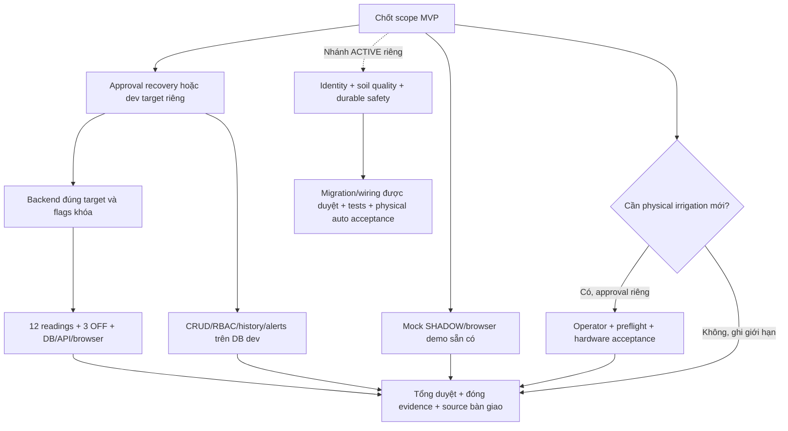

# Remaining work — P0 / P1 / P2

## Trạng thái hiện hành — software P0 đã đóng29/10/2026

**P0 software DEV/SIMULATOR còn mở:0. MVP_DEV_UI_ACCEPTED / MVP_DEV_SOFTWARE_ACCEPTED.** Bốn ca livepagination đãPASS;khôngcòn dùng“chưaverifyresetpage” làmblocker. Khôngpháthoặccộnglạicác43API/22checkpoint/CRUD/pollingtestsđãđạt.

P0toàndựán trướcdefense còn:nghiệmthuRealESP32E2Ehiện tại,chốt automaticphysical/scopegiảngviên,hoàn thiệnảnh/Word/vàdiễntậpdemo. Khôngnhầmsoftwareacceptancevớiphầncứng.

P1/ngoạilệ:OS-nativevisibility,profilingdàihạn,UIpolishmobile;computedSHADOWthiếutargetgiữNOT_VERIFIED_DEVtheophạmviđãchấpthuận. KhôngmởR2.x hoặcđòiproductionmigrationđểdemoDEV. DịchvụDEVđãdừngsạch,DBvàcredentialsđượcgiữ.

[PART A–I](MVP_DEVELOPMENT_RUNTIME_ACCEPTANCE.md). Phầndưới là lịch sử;khôngmởlạisoftwareP0đãđóng.

---

## P0 mới nhất — FINAL GAP CLOSURE29/10/2026

- ĐãđóngcácUIgaps:no-data,responsive,history/chart/stats/customrange/CSV,alerts,usercreate/edit/role/status/validation,logout/Axios401,irrigationdisabled. Auth/dashboard/polling/race/retry/unmountPASStrướcgiữnguyên,khôngrerunđểcộngsố.
- **P0duynhấtcònmở:** liveconfirmationcủaresetpaginationHistory khiđổitype/farm/zone. Cóbugthựcpages2/1;đãsửa3handlerssetPage(1),1actualpageofflinefixturetestPASS,frontendtypecheck/lintPASS. KhônggọipostfixlivePASS.
- Khôngrestarttrongphiênđãtiêuthụ;khôngprovisioning/migration/seed/reset. Dữliệugiữ41SIMULATORreadings,2resolvedalerts,8users;newacceptanceIDsởbáocáo.
- SHADOWcomputedpreviewkhôngtargetDEVgiữNOT_VERIFIEDnonblockingtheophạmviđãduyệt. Nativevisibility/longtermprofile,P1mobilepolishkhôngcảntrởcáccaseđãPASS.
- ESP32live vàautomaticphysicalscope/nghiệmthuđồánvẫncầnchốtriêng. KhôngR2.x/productionmigrationđểsửalỗipagination.

[PART A–J](MVP_DEVELOPMENT_RUNTIME_ACCEPTANCE.md). VerdictMVP_DEV_UI_PARTIAL;phầndướilàlịchsử.

---

## P0 sau live UI29/10/2026,16:15

- Đã đóng: React/CSS render trên Edge,login3role/RBAC,dashboard4sensors/LIGHT0,pollingnoF5DB→API→UI/UTC+7,scope/errorrecovery/unmount. Không lặp các phần này như chưaPASS.
- Phiên dừng do selector harness no-data khớp sai exact-name, không phải chứng minh app hỏng. Đã sửa/testoffline bằng actualcomponent1PASS. Không tự khởiđộngDEVlần2.
- Còn: no-data/responsive live,history/chart/customrange/CSV/pagination/alerts,usercreate/edit/role/status/logout,irrigation/SHADOWlabel,401sessionredirect;nativehidden/nooverlapchưađủbằngchứng.
- Cần phiên startup-only mới theo phêduyệt riêng trênDEV hiện hữu,khôngseed/migration/reset/provisioning. Dữliệuđãcó38SIMULATORreadings,gồm1readingacceptance42.625đượcgiữ.
- SHADOWfixedidentitygiữguard;previewcomputedcóthểNOT_VERIFIED theo scope đãduyệt,khôngtạofakeESP. Automaticphysical/ESP32E2Evàscopecủagiảngviênvẫntáchriêng.

[EvidenceA–K](MVP_DEVELOPMENT_RUNTIME_ACCEPTANCE.md). VerdictMVP_DEV_UI_PARTIAL;phầndưới làlịchsử.

---

## P0 sau phiên29/10/2026

- Đã PASS: existing DEV startup-only,6nhómCRUDAPI/status/assignmentDELETE/profileupdate,26HTTPrequests,vàgracefulcleanup. Không thêmDDL/migration/seed/reset.
- Root blocker mới xác định: Tailwind mất config do privatecwd;ring-brand-500 gây /src/index.css500. Đã sửa riêng DEVlauncher và6offlinechecksPASS;livefixNOT_VERIFIED.
- Phiên đã dùng hết lượt startup được duyệt vàđãstop; khôngtựretry. Bước tiếp theo là startup-only/browseracceptance riêng sauphêduyệt, khôngprovisioning hoặc tạo cluster.
- Chưa xong: thực sựrenderReact,login3role/authorizationUI,DashboardnoF5/race/history/chart/UTC+7/CSV/alerts/userstatus/logoutUI. Không quy APIpassthànhbrowserpass.
- HardDELETEtổngquát không phảiP0bắtbuộc theo contract;staffassignmentDELETEđãPASS,statusdisableentitiesđãPASS. Cònuserrole/statusmutationschưaobserved.
- SHADOWpreviewfixeddevice cần giải phápfixtureminhbạch;auto vật lý/scopegiảngviên chốtriêng. KhôngđòihoànthànhmọiPhase13.5.

[Chi tiếtA–J](MVP_DEVELOPMENT_RUNTIME_ACCEPTANCE.md). Kếtluận hiện hànhMVP_DEV_UI_AND_CRUD_PARTIAL;phầndưới làlịchsử.

---

## P0 hiện hành sau DEV execution28/10

- Đã xong: TEST credentials,DEV database/roles,11 migrations,fixtures,43 API checks,runtime safety và graceful cleanup. Không reset mật khẩu hoặc provisioning/migration lại.
- Còn chặn: nghiệm thu Edge trên existing DEV (login,roles,dashboard,polling,UTC+7,charts/history,alerts,irrigation disabled,SHADOW). Edge executable lookup đã sửa; smoke offline PASS chưa thay browser app PASS.
- Bổ sung DELETE CRUD/user-management mutations còn thiếu. Không coi43 API checks bao phủ mọi thao tác hoặc browser.
- Phiên kế tiếp cần startup/acceptance-only scope cho TEST55433 + backend55001/frontend55173; dùng private DPAPI credentials, không DBA reset/DDL/seed lại. Database hiện giữ nguyên sau cleanup.
- Chốt phạm vi automation cho bảo vệ. P1 ổn định/hardware acceptance và P2 production ledger hardening vẫn tách riêng, không buộc hoàn tất toàn bộ Phase13.5 trước software demo.

Verdict hiện hành MVP_DEV_SOFTWARE_PARTIAL. [Chi tiết](MVP_DEVELOPMENT_RUNTIME_ACCEPTANCE.md). Các blocker credential trước đây phía dưới đã được tháo gỡ.

**Đã xử lý blocker credential TEST28/10.** MVP_TEST_CREDENTIAL_RECOVERY_PASS; TEST55433 dừng sạch. Không cần reset/initdb hoặc thử lại mật khẩu. Bước tiếp theo là phiên DEV provisioning/acceptance được duyệt, dùng password TEST mới do operator giữ và nhập cục bộ. File credential cũ chưa cập nhật, không tự đọc/fallback. [Báo cáo hiện hành](MVP_DEVELOPMENT_RUNTIME_ACCEPTANCE.md). Các checkpoint bên dưới là lịch sử.

**Latest TEST recovery diagnostic:** runner exit1 root cause identified as missing system PATH in the cleared .NET child environment. Reproduced failure and fixed pipeline with synthetic input only;18/18 related tests PASS plus native offline transport checks. Real reset/authentication still pending; no production or DEV startup. See [current report](MVP_DEVELOPMENT_RUNTIME_ACCEPTANCE.md).

**TEST recovery checkpoint28/10 (newer than direct-auth failure):** operator confirmed original credential unusable. Offline TEST backup6764files/188362787bytes verified; single-user READ ONLY proved phase13_test_admin exists with LOGIN/provisioning privileges, exit0.16/16 related offline tests PASS; reset/authentication pending local operator confirmation/password entry. [Current recovery evidence](MVP_DEVELOPMENT_RUNTIME_ACCEPTANCE.md). No DEV provisioning/startup, production writes or hardware actions. Prior authentication failures remain historical; role absence/insufficient privilege is no longer an unverified hypothesis. No live acceptance status is upgraded yet.

Ngày28/10/2026. Ngừng mở feature mới; ưu tiên chốt MVP theo [matrix](FINAL_ACCEPTANCE_MATRIX.md). Effort dưới đây là ước lượng công việc, không phải yêu cầu chạy monitor chờ nhiều giờ.

**Blocker mới đã chứng minh:** existing TEST role phase13_test_admin chưa xác thực được trong [phiên DEV](MVP_DEVELOPMENT_RUNTIME_ACCEPTANCE.md). TEST đã smart-stop; chưa tạo DEV database/roles. Việc tiếp theo là xác minh đúng credential TEST cục bộ và chuẩn bị phiên tiếp tục được duyệt, không reset password hoặc chuyển production. Không lặp phase/R2.x hoặc suy rằng cần initdb lại.

Direct `psql -W` đã được thử đúng một lần trong phiên mới và cũng bị từ chối. Không tiếp tục thử password/role khác. P0 hiện tại: operator kiểm tra credential gốc TEST tại máy; nếu không có, chọn phương án TEST-only recovery có approval hẹp riêng. Chưa có lý do sửa firmware, automation engine hoặc initdb/migration production để xử lý lỗi xác thực.

## P0 — Chặn demo/bảo vệ

| ID | Việc | Done khi | Phụ thuộc / quyền |
|---|---|---|---|
| P0-01 | Chốt phạm vi automatic | Người phụ trách đồng ý SHADOW hay yêu cầu physical; ghi rõ trong slide/matrix | Quyết định phạm vi, không tự coi auto đã xong |
| P0-02 | Khôi phục target demo/backend | Đúng target/process/API5000, PostgreSQL/MQTT connected; false/false/test true/cap 1/gatewayDISABLED và PENDING/count được xác minh mới | **Approval startup/recovery mới**, bao gồm recovery DB writes; không dùng approval cũ |
| P0-03 | E2E monitoring thật |3 batches / 12 readings mới khớp MQTT→DB→API→browser;3 PERIODIC OFF,ONLINE; khôngF5, zero đúng, thời gian7+ | P0-02; không bơm, không reset/flash |
| P0-04 | CRUD/RBAC/history/alerts acceptance | ADMIN/OWNER/STAFF, outside-scope, CRUDvalid/invalid; chart/filters; threshold→ack→recover được kiểm trên development DB riêng | Approval provisioning/fixtures cho dev DB riêng nếu chưa có; không ghi test production |
| P0-05 | Chốt manual/hardware evidence | Phạm vi báo cáo phù hợp evidence; nếu claim chạy/nước, có xác nhận vật lý và session mới được duyệt, không retry | Approval phần cứng mới chỉ nếu cần; không tái dùng haiON lịch sử |
| P0-06 | Tổng duyệt và source handoff | Kịch bản10–12phút chạy2lần, fallback simulation; báo cáo/ảnh đã gắn nhãn; source không secrets, có config example/build instructions | P0-01..05 theo scope; commit/push chỉ khi được yêu cầu |

P0-04 không đòi migration6 ledger: chỉ cần baseline11migration hiện hữu trên **development target đã duyệt**. Login/CRUD tests có ghi DB không được chạy tự động trên target hiện tại.

Nếu requirement bắt buộc automatic hardware: thêm P0-AUTO, review đường demo **development cô lập** với evaluator hiện có trước; thử sensor→rule→command→ACK bằng mock gateway, rồi mới đề xuất phiên phần cứng được duyệt. Cần cap/cooldown, dữ liệu mới, OFFLINE/UNKNOWN fail-closed, clock guard, không retry khi timeout và operator ngắt nguồn. Không tự bỏ gate hoặc gọi SHADOW là phần cứng. Nếu chọn ACTIVE theo kiến trúc Phase13 mới thì các gate identity/quality/durable safety của kiến trúc đó vẫn phải đạt; không suy mọi hardening production/migration6ledger bắt buộc cho mọi phương án MVP dev.

## P1 — Ổn định vận hành và bàn giao

| Việc | Cách hoàn thành giới hạn |
|---|---|
| Credential rotation/revocation | Wi-Fi/deviceMQTT đã phơi lộ: operator nhập local, rollout/flash cần approval riêng; không print secrets; backendcredential chỉ rotate nếu có quyết định/evidence |
| SOIL calibration | Đo dry/wet tại chỗ, ghi version/endpoints/range/uncertainty; không dùng phần trăm chưa chuẩn làm bằng chứng điều khiển chính xác |
| SNTP periodic callback/recovery | Thu log callback khi thiết bị vận hành bình thường; không bắt60phút ở mọi demo; không giả callback từ telemetryfresh |
| Startup bền vững | Root cause backendexit còn UNKNOWN; log stdout/stderr/nativeexit, tránh gắn vòng đời API vào phiên agent ngắn; task/service cần phê duyệt riêng, không cài ngay |
| Network stability | Chọn hotspot/router cố định, brokerIPv4/operator kiểm tra; không tự đổi IP/firmware/firewall; không chạy brokerLAN thứhai |
| Error/reconnect,tab/scope races | Browser mocks trước; live chỉ sau targetapproval; giữ dữ liệu/timebackend, không giả ONLINE/OFF |
| Git/release | Review local changes/untracked rất lớn, `.env`/configlocal ignored, không đưa firmwarebin chứa secrets; tạo source release có thể clone/build |
| Backup/off-device copy | C.7restore PASS lịch sử không phải backup mới nhất; hoạch địnhRPO riêng, không chạy backup mới trong audit |

Credentials là P0 trước public/shared-network deployment hoặc bàn giao chứa cấu hình thật; không được trì hoãn bằng nhãn P1 trong trường hợp đó.

## P2 — Sau nghiệm thu MVP hoặc nhánh ACTIVE riêng

- Production migration6 ledger, role provisioning/Prisma reconciliation và wiring; không bắt buộc để demo monitoring/SHADOW.
- Publisher assurance/device identity/anti-replay durable, SOIL signedmetadata, clock adapter đủ VERIFIED_LIVE; bắt buộc trước ACTIVE được thiết kế hiện tại.
- Durable daily budget/quota/safety latches deployment và multi-process concurrency production.
- TLS/public hosting/observability dài hạn theo môi trường đích; tối ưu chunk519kB khi có nhu cầu, không chặn build/demo LAN.
- R2.5/SQL R1/recovery-adapter hardening nếu tiếp tục đường công cụ hiện tại. Không phải chức năng cần trình hội đồng và không được dùng để kéo dài critical path vô hạn.

## Dependency graph và critical path

**Critical path ngắn:** scope→approval target→backend→live monitoring/browser→tổng duyệt. CRUD và mock chạy song song về logic công việc; không cần thêm agents hoặc dịch vụ production. Thời lượng làm việc dự kiến1–2buổi sau khi có target/approval/tài khoản, không cam kết khi môi trường chưa được xác minh.

## Tách3 quyết định

1. **Isolated development/test:** có thể chạy ngay QA offline/mock đã bàn giao; provisioning/startDB/seed mới cần targetapproval riêng. Không copy productiondata mặc định.
2. **Production recovery:** request hẹp chỉ một startup, kh?ng DDL, flagsfalse, fresh state, kiểm count/PENDING; startup có writes nên chưa làm trong audit.
3. **Production migration:** hoàn toàn tách recovery. Không mặc định approvalbackup/restore hoặc R2.4 cho phép DDL.

Phase tiếp theo nên là **MVP runtime recovery & final E2E acceptance** theo scope được duyệt, không tự chuyển R2.5 hoặc migration. Các phần offline đã bàn giao không cần chạy lại chỉ để đổi tên phase.
